# Git与GitLab的企业实战

# 第1章 Git概述

Git是一个免费的、开源的分布式版本控制系统，可以快速高效地处理从小型到大型的各种项目。

Git易于学习，占地面积小，性能极快。 它具有廉价的本地库，方便的暂存区域和多个工作流分支等特性。其性能优于Subversion(svn)、CVS、Perforce和ClearCase等版本控制工具。

## 1. 何为版本控制

版本控制是一种记录文件内容变化，以便将来查阅特定版本修订情况的系统。

版本控制其实最重要的是可以记录文件修改历史记录，从而让用户能够查看历史版本，方便版本切换。

 


## 2. 为什么需要版本控制

个人开发过渡到团队协作。

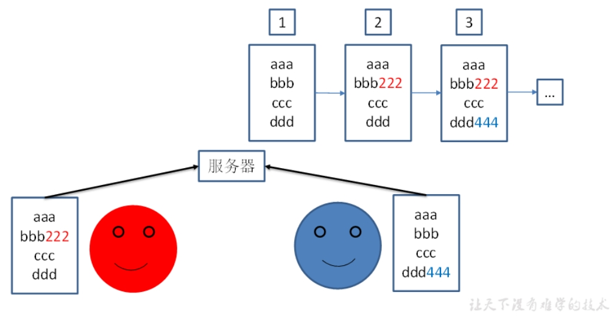 

## 3. 版本控制工具

* **集中式版本控制工具**

CVS、SVN(Subversion)、VSS……

集中化的版本控制系统诸如 CVS、SVN等，都有一个单一的集中管理的服务器，保存所有文件的修订版本，而协同工作的人们都通过客户端连到这台服务器，取出最新的文件或者提交更新。多年以来，这已成为版本控制系统的标准做法。

这种做法带来了许多好处，每个人都可以在一定程度上看到项目中的其他人正在做些什么。而管理员也可以轻松掌控每个开发者的权限，并且管理一个集中化的版本控制系统，要远比在各个客户端上维护本地数据库来得轻松容易。

事分两面，有好有坏。这么做显而易见的缺点是中央服务器的单点故障。如果服务器宕机一小时，那么在这一小时内，谁都无法提交更新，也就无法协同工作。

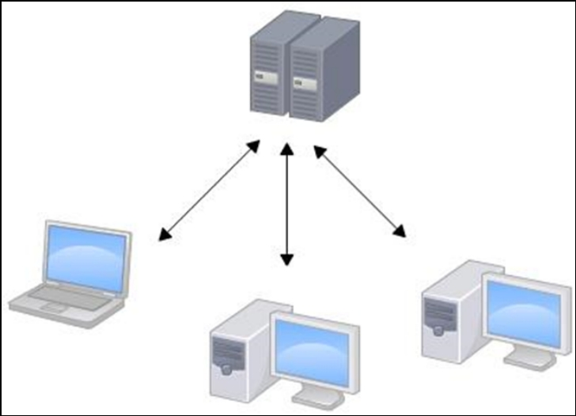 

* **分布式版本控制工具**

Git、Mercurial、Bazaar、Darcs……

像 Git这种分布式版本控制工具，客户端提取的不是最新版本的文件快照，而是把代码仓库完整地镜像下来（本地库）。这样任何一处协同工作用的文件发生故障，事后都可以用其他客户端的本地仓库进行恢复。因为每个客户端的每一次文件提取操作，实际上都是一次对整个文件仓库的完整备份。

分布式的版本控制系统出现之后,解决了集中式版本控制系统的缺陷:

1. 服务器断网的情况下也可以进行开发（因为版本控制是在本地进行的）

2. 每个客户端保存的也都是整个完整的项目（包含历史记录，更加安全）

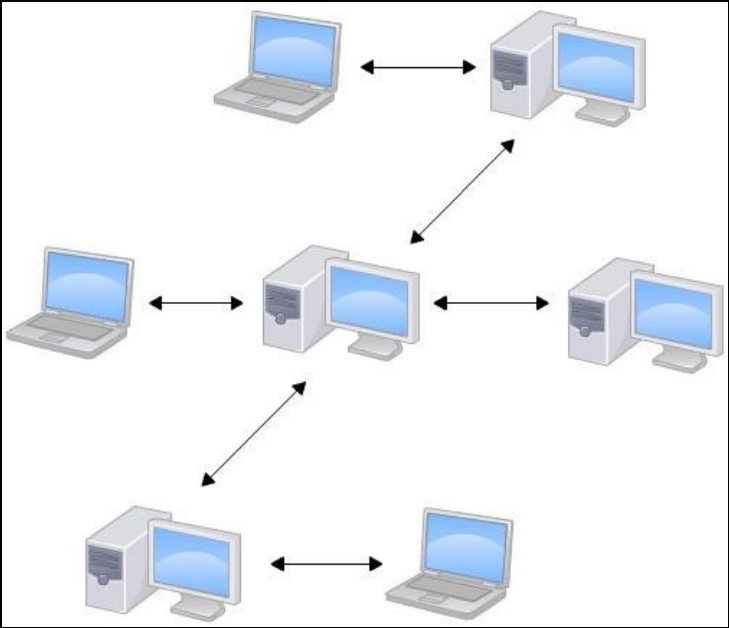 


## 4. Git简史

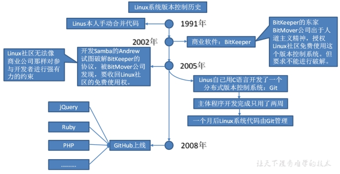 


## 5 Git工作机制


## 6 Git和代码托管中心

代码托管中心是基于网络服务器的远程代码仓库，一般我们简单称为远程库。

* **局域网**

GitLab

* **互联网**

GitHub（外网）

Gitee码云（国内网站）

 

# 第2章 Git安装

​		官网地址： https://git-scm.com/或https://github.com/git-for-windows/git/releases 

​		查看GNU协议，可以直接点击下一步。

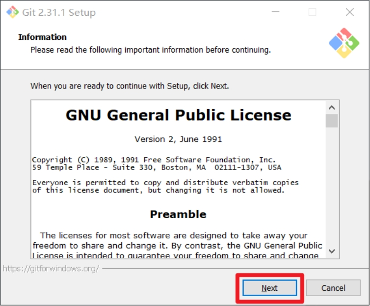 

选择Git安装位置，要求是非中文并且没有空格的目录，然后下一步。

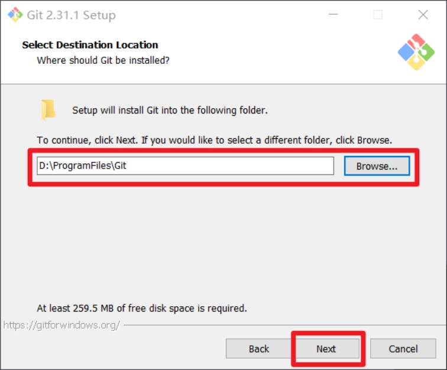 

Git选项配置，推荐默认设置，然后下一步。

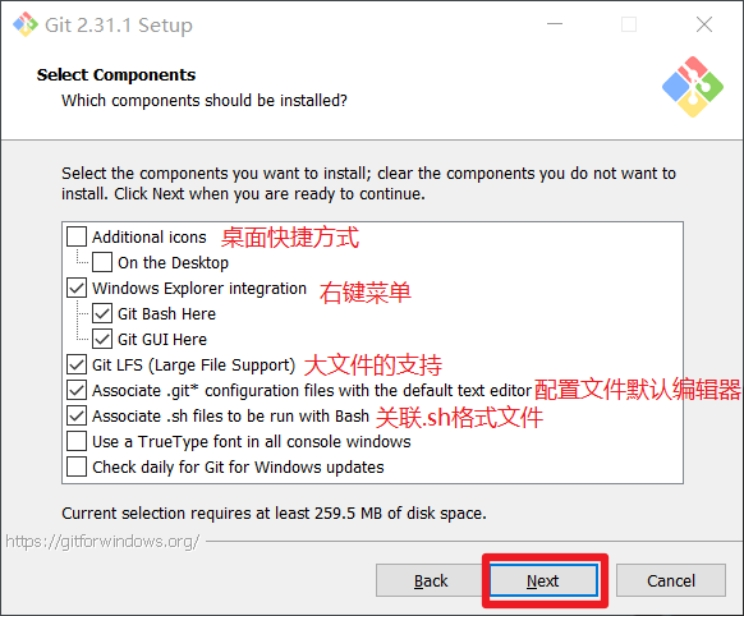 

Git安装目录名，不用修改，直接点击下一步。

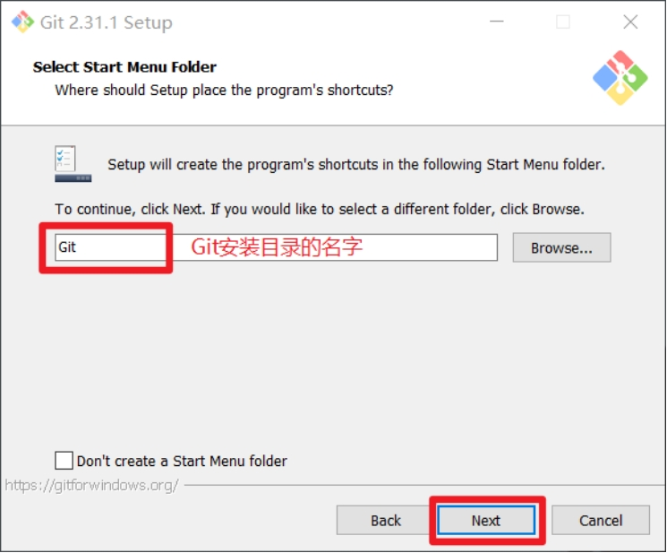 

Git的默认编辑器，建议使用默认的Vim编辑器，然后点击下一步。

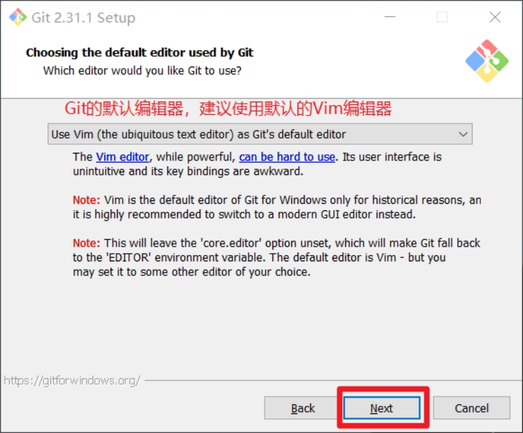 

默认分支名设置，选择让Git决定，分支名默认为master，下一步。 

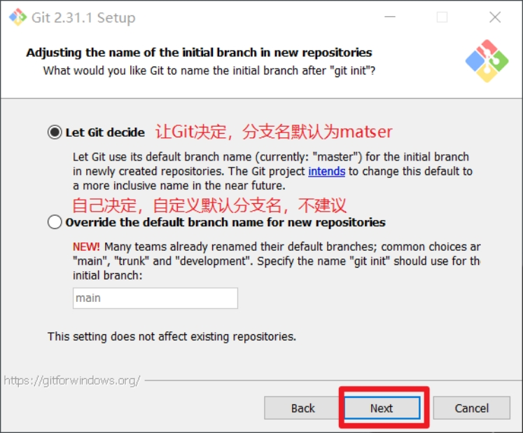 

修改Git的环境变量，选第一个，不修改环境变量，只在Git Bash里使用Git。 

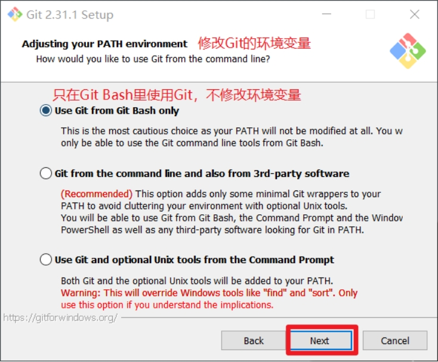 

选择后台客户端连接协议，选默认值OpenSSL，然后下一步。 

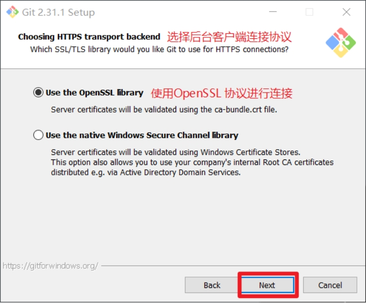 

配置Git文件的行末换行符，Windows使用CRLF，Linux使用LF，选择第一个自动转换，然后继续下一步。 

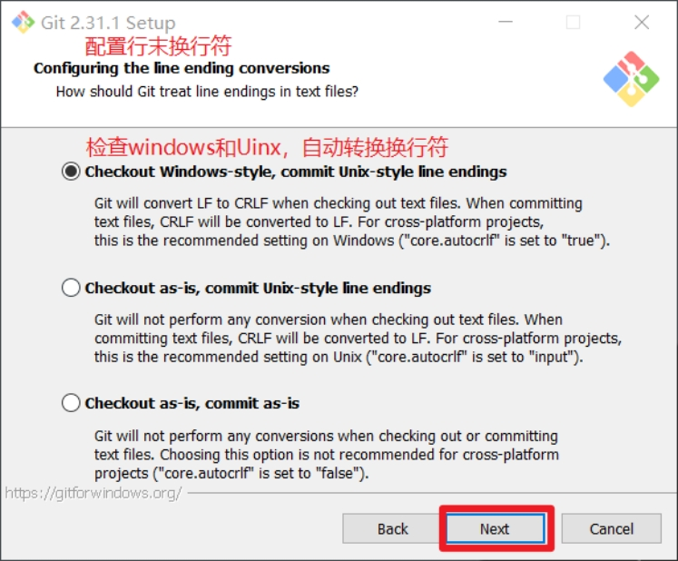 

选择Git终端类型，选择默认的Git Bash终端，然后继续下一步。

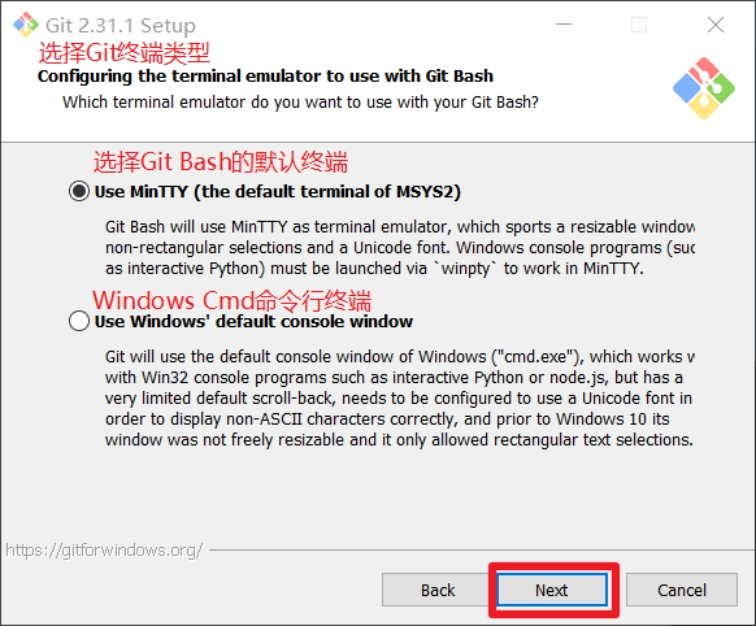 

选择Git pull合并的模式，选择默认，然后下一步。

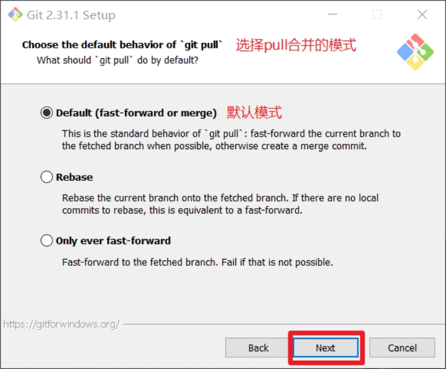 

选择Git的凭据管理器，选择默认的跨平台的凭据管理器，然后下一步。

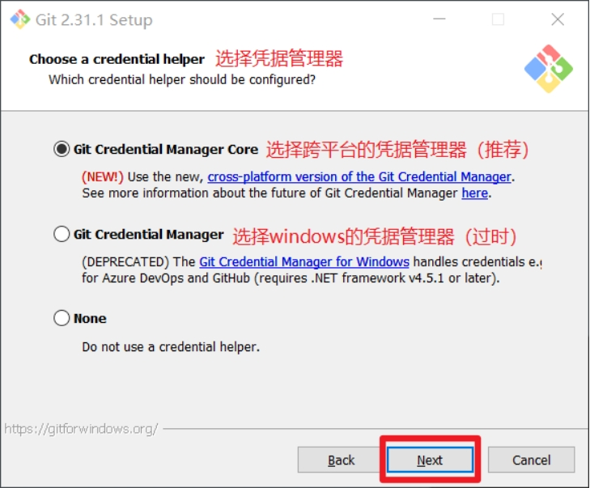 

其他配置，选择默认设置，然后下一步。

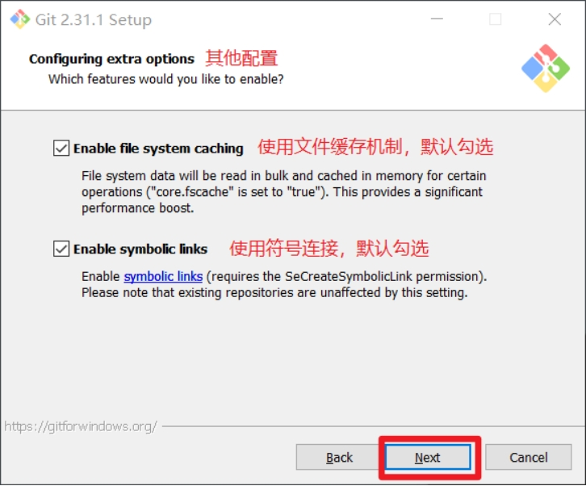 

实验室功能，技术还不成熟，有已知的bug，不要勾选，然后点击右下角的Install按钮，开始安装Git。

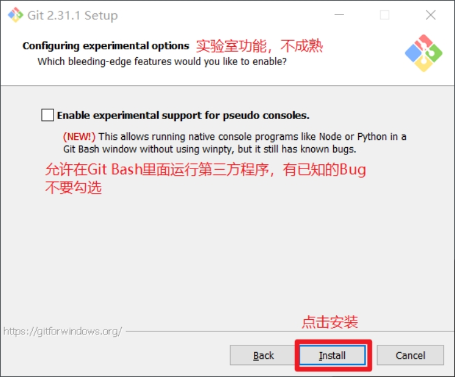 

点击Finsh按钮，Git安装成功！

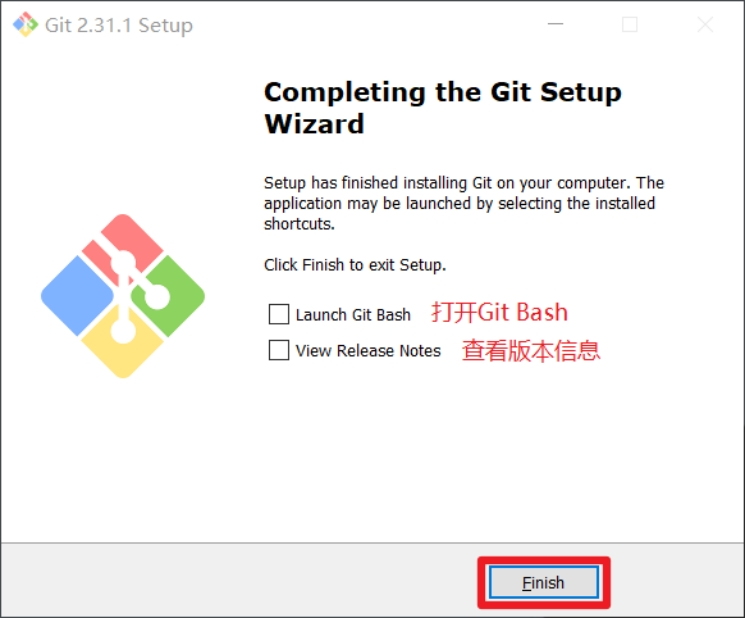 

右键任意位置，在右键菜单里选择Git Bash Here即可打开Git Bash命令行终端。

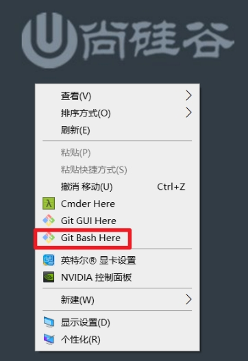 

在Git Bash终端里输入git --version查看git版本，如图所示，说明Git安装成功。

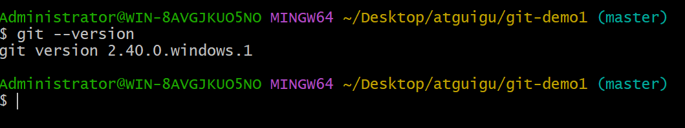 

 

# 第3章 Git常用命令

| **场景**               | **命令**                                                |
| ---------------------- | ------------------------------------------------------- |
| **我要存代码**         | `git add .` -> `git commit -m "添加描述"` -> `git push` |
| **我不确定现在改了啥** | `git status`                                            |
| **我想拿最新的代码**   | `git pull`                                              |
| **我想看以前改了啥**   | `git log`                                               |


| **命令名称**                         | **作用**       |
| ------------------------------------ | -------------- |
| git config --global user.name 用户名 | 设置用户签名   |
| git config --global user.email 邮箱  | 设置用户邮箱   |
| git init                             | 初始化本地库   |
| git status                           | 查看本地库状态 |
| git add 文件名                       | 添加到暂存区   |
| git commit -m "日志信息" 文件名      | 提交到本地库   |
| git reflog                           | 查看历史记录   |
| git reset --hard 版本号              | 版本穿梭       |

## 1 设置用户签名

### 1.1 基本语法

git config --global user.name 用户名

git config --global user.email 邮箱

### 1.2 案例实操

全局范围的签名设置：

```shell
git config --global user.name yhm
git config --global user.email yaohm7788@163.com
git config --list # 查看全局配置
cat ~/.gitconfig  # cat linux中查看文本的命令  ~ 家 [你当前用户的家]/ .gitconfig
```

说明：

签名的作用是区分不同操作者身份。用户的签名信息在每一个版本的提交信息中能够看到，以此确认本次提交是谁做的。Git首次安装必须设置一下用户签名，否则无法提交代码。

※注意：这里设置用户签名和将来登录GitHub（或其他代码托管中心）的账号没有任何关系。


## **2** **初始化本地库** 

### 2.1 基本语法

**git init**

### 2.2 案例实操

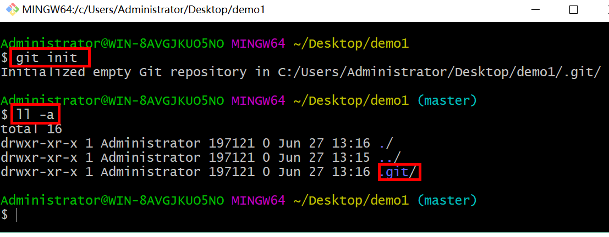

结果查看

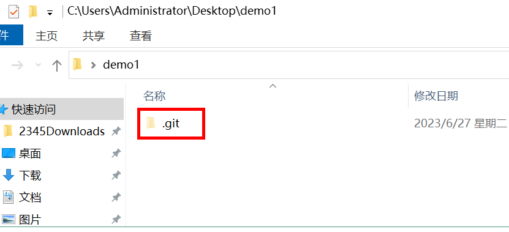 

 

## **3** **查看本地库状态**

### 3.1 基本语法

**git status**


### 3.2 案例实操

#### （1）首次查看（工作区没有文件）

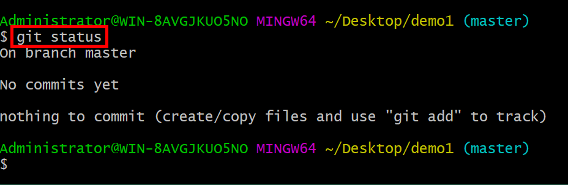

#### （2）新增文件

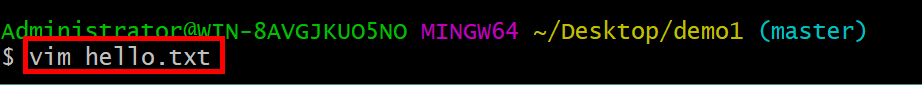

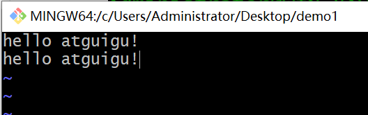

####  （3）再次查看（检测到未追踪文件）

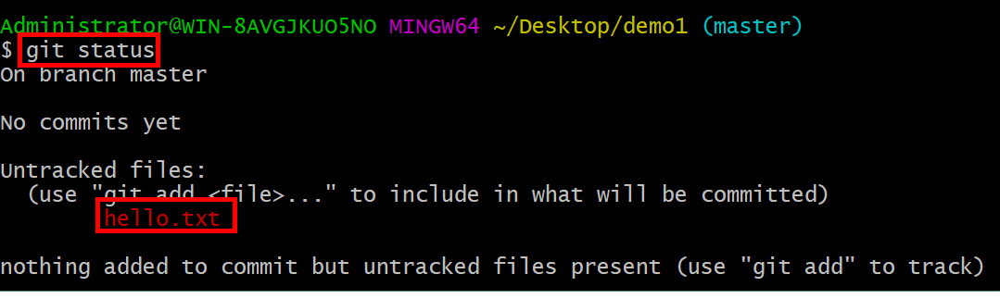


## 4 添加暂存区

### 4.1 将工作区的文件添加到暂存区

#### （1）基本语法

**git** **add** **文件名**

#### （2）案例实操

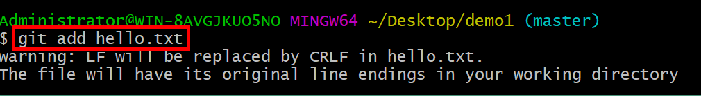


### 4.2 查看状态（检测到暂存区有新文件）

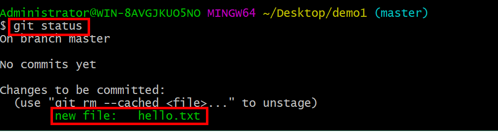


## 5 提交本地库

### 5.1 暂存区文件提交到本地库

#### （1）基本语法

**git commit -m "日志信息" 文件名**

#### （2）案例实操

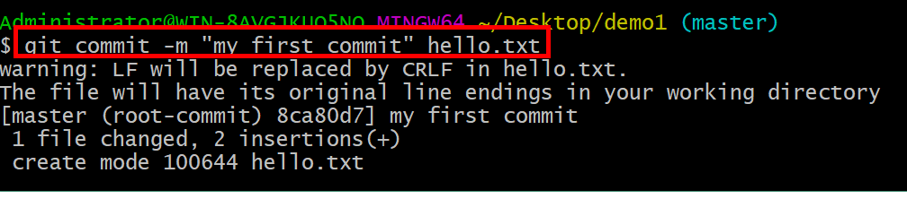

### 5.2 查看状态（没有文件需要提交）

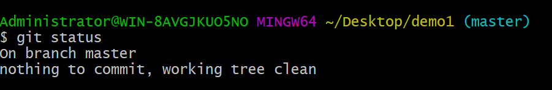


## 6 修改文件（hello.txt）

### 6.1 查看状态（检测到工作区有文件被修改）

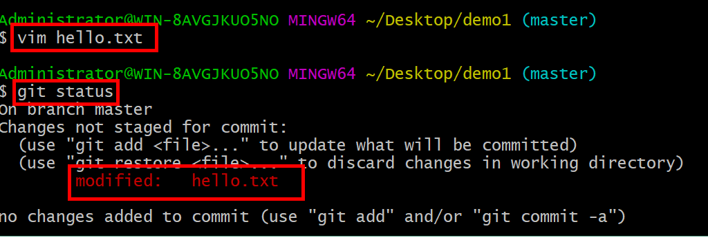


### 6.2 将修改的文件再次添加暂存区

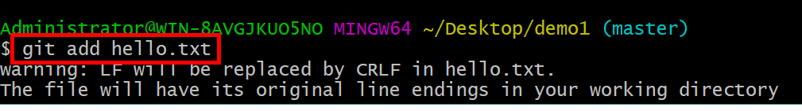


### 6.3 查看状态（工作区的修改添加到了暂存区）

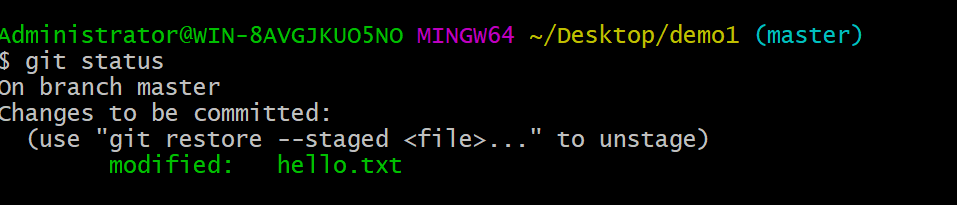

 

### 6.4 将暂存区文件提交到本地库

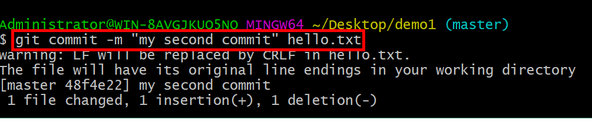

 

## 7 历史版本

### 7.1 查看历史版本

#### （1）基本语法

**git reflog**  **查看版本信息**

git reflog -n 数量

**git log**  **查看版本详细信息**

#### （2）案例实操

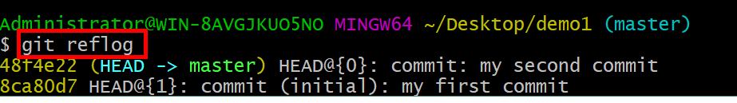


### 7.2 版本穿梭

#### （1）基本语法

**git reset --hard** **版本号**

#### （2）案例实操

--首先查看当前的历史记录，可以看到当前是在48f4e22这个版本

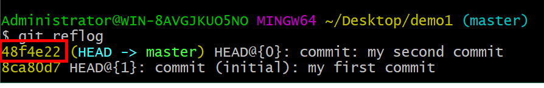

 

--切换到之前版本，8ca80d7版本，也就是我们第一次提交的版本

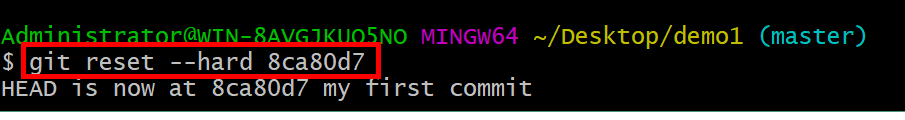

 

--切换完毕之后再查看历史记录，当前成功切换到了8ca80d7版本

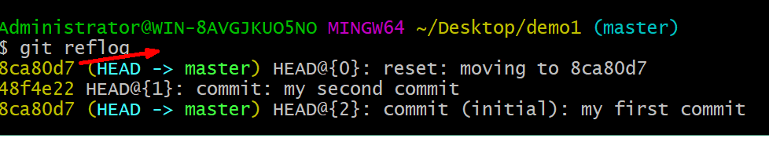

 

--然后查看文件hello.txt，发现文件内容已经变化

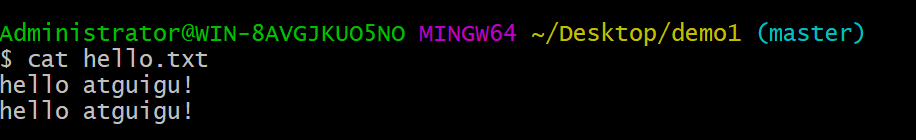

 Git切换版本，底层其实是移动的HEAD指针。


# 常用指令速查

| **场景**   | **指令**                                 | **说明**                                 |
| ---------- | ---------------------------------------- | ---------------------------------------- |
| **配置**   | `git config --global user.name "name"`   | 设置提交时的用户名                       |
|            | `git config --global user.email "email"` | 设置提交时的邮箱                         |
| **开始**   | `git init`                               | 在当前目录初始化一个新仓库               |
|            | `git clone <url>`                        | 克隆远程仓库到本地                       |
| **日常**   | `git status`                             | **最常用**：查看当前文件状态             |
|            | `git add .`                              | 将所有修改添加到暂存区                   |
|            | `git add <file>`                         | 将指定文件添加到暂存区                   |
|            | `git commit -m "msg"`                    | 提交暂存区内容到本地仓库                 |
|            | `git log --oneline`                      | 查看简洁的提交历史                       |
|            | `git diff`                               | 查看工作区与暂存区的差异                 |
| **分支**   | `git branch`                             | 查看所有本地分支                         |
|            | `git branch <name>`                      | 创建新分支                               |
|            | `git switch <name>`                      | **推荐**：切换到指定分支                 |
|            | `git checkout -b <name>`                 | 创建并切换到新分支                       |
|            | `git merge <name>`                       | 将指定分支合并到当前分支                 |
|            | `git branch -d <name>`                   | 删除分支（`-D` 强制删除）                |
| **远程**   | `git pull`                               | 拉取远程代码并合并（等于 fetch + merge） |
|            | `git push origin <branch>`               | 将本地分支推送到远程                     |
|            | `git remote -v`                          | 查看远程仓库地址信息                     |
| **后悔药** | `git checkout -- <file>`                 | 丢弃工作区文件的修改（未 add）           |
|            | `git reset HEAD <file>`                  | 把文件从暂存区撤回到工作区（已 add）     |
|            | `git stash`                              | 暂时封存当前修改（去修 Bug 时用）        |
|            | `git stash pop`                          | 恢复之前封存的修改                       |
