# 模型上下文协议 (MCP) 深度技术架构与生态演进研究报告

## 执行摘要

随着大语言模型（LLM）从单纯的文本生成工具向具备自主行动能力的智能体（Agents）演进，人工智能系统工程面临着前所未有的挑战：**上下文隔离（Context Isolation）**。尽管模型本身具备广博的通用知识，但它们在本质上与企业专有数据、实时业务系统以及本地操作环境是断开连接的。传统的解决方案通常依赖于碎片化的、点对点的集成代码（Glue Code），这种模式不仅维护成本高昂，且难以扩展。

Anthropic 于 2024 年底推出的 **模型上下文协议（Model Context Protocol, MCP）**，代表了一种旨在打破这种碎片化局面的范式转移。正如 USB-C 接口标准化了电子设备之间的数据与电力传输，MCP 旨在标准化 AI 宿主应用（Host）与外部数据源或工具（Server）之间的连接。

本报告基于用户提供的架构图表（图1-6）及广泛的技术文档，对 MCP 进行了详尽的解构。我们将从协议的底层架构出发，深入探讨其生命周期管理、核心原语（Primitives）、通信机制、安全性设计以及开发实战，旨在为初学者及资深工程师提供一份能够从概念认知跨越到生产级部署的权威指南。报告还将分析 MCP 如何重塑“代理式网络（Agentic Web）”的未来，以及这一协议对软件架构的深远影响。

------

## 1. 上下文危机与 MCP 的诞生逻辑

在深入技术细节之前，必须理解 MCP 试图解决的核心问题。在传统的检索增强生成（RAG）或工具调用（Tool Use）架构中，连接逻辑往往是硬编码在编排层（Orchestration Layer）中的。这意味着，如果你希望你的 AI 助手能够访问 Google Drive，你需要专门编写针对 Google Drive API 的适配器；如果你还需要它访问本地的 PostgreSQL 数据库，又需要编写另一套截然不同的集成代码。

这种模式导致了 **M×N 的复杂度问题**：如果有 M 个 AI 客户端（如 Claude Desktop, Cursor, VS Code, Zed）和 N 个数据源（GitHub, Slack, PostgreSQL, Local Filesystem），理论上需要开发 M×N 个集成插件。

MCP 通过引入通用的 **客户端-服务器（Client-Server）** 架构，将这一复杂度降低为 **M+N**。任何实现了 MCP 协议标准的服务器（Server），都可以被任何支持 MCP 协议的客户端（Host/Client）直接使用，无需重新编写集成代码 1。

------

## 2. MCP 核心架构解析：宿主、客户端与服务器

基于用户提供的 **Image 1 (4.1 MCP的C/S架构)** 和 **Image 2, 3, 4**，MCP 的架构由三个核心角色组成，它们共同构成了一个解耦的智能生态系统。

### 2.1 MCP Host（MCP 主机）：编排与交互的中枢

**定义**：MCP Host 是包含大语言模型（LLM）并与用户直接交互的主应用程序。典型的例子包括 Claude Desktop App、Cursor IDE、Cline 插件以及各种 AI 工作台 4。

**职责与机制**：

- **用户意图捕获**：Host 负责接收用户的自然语言输入（Image 5 中的步骤1）。
- **上下文聚合**：Host 并不直接产生上下文，而是通过管理一个或多个 MCP Client 来聚合外部信息。它负责将分散在不同 Server 中的工具描述、资源内容和提示模版汇总，并注入到 LLM 的上下文窗口（Context Window）中 6。
- **安全守门人**：Host 掌握着最终的执行权。当 LLM 决定调用某个工具（如删除文件或发送邮件）时，Host 负责向用户展示审批请求（Image 5 中的步骤4），确保“人在回路（Human-in-the-Loop）”的安全性 7。

### 2.2 MCP Client（MCP 客户端）：协议的翻译官

**定义**：MCP Client 是 Host 内部的一个组件，它与特定的 MCP Server 建立一对一的连接 4。需要注意的是，Host 和 Client 是包含关系，但功能截然不同。Host 是容器，Client 是连接器。

**职责与机制**（基于 Image 3）：

- **协议协商**：在连接初始化阶段，Client 负责与 Server 交换能力清单（Capabilities），确认双方支持的协议版本和功能特性（如是否支持采样 Sampling 或进度通知 Progress）。
- **消息路由**：Client 将 Host/LLM 的高层意图转化为符合 JSON-RPC 2.0 规范的消息格式，并通过传输层发送给 Server。
- **生命周期管理**：Client 监控连接的健康状态，处理重连逻辑，并负责优雅地关闭连接。

**架构洞察**：MCP 强制要求 Client 与 Server 之间保持 **1:1** 的关系。这意味着，如果 Claude Desktop 同时连接了 GitHub 和本地文件系统，它实际上在后台实例化了两个独立的 MCP Client 对象，分别维护两条独立的通信管道。这种设计最大程度地隔离了故障——GitHub 连接的超时不会影响本地文件系统的操作 5。

### 2.3 MCP Server（MCP 服务器）：能力的提供者

**定义**：MCP Server 是一个独立的进程或网络服务，它封装了底层的 API、数据库查询或文件操作逻辑，并通过标准化的 MCP 协议暴露给外界 3。

**职责与机制**（基于 Image 4）：

- **能力暴露**：Server 通过声明 **Resources（资源）**、**Tools（工具）** 和 **Prompts（提示）** 三大原语，告知 Client 它能做什么。
- **执行逻辑**：Server 是真正“干活”的地方。它接收来自 Client 的 `tools/call` 请求，执行具体的代码（例如运行 SQL 查询或读取文件），并将结果封装为 JSON-RPC 响应返回。
- **本地与远程**：Server 既可以是运行在用户机器上的本地进程（Local Server），也可以是部署在云端的远程服务（Remote Server）。

**架构洞察**：Server 的设计体现了“智能与执行分离”的原则。Server 本身不需要包含 LLM，也不需要理解复杂的自然语言，它只需要忠实地执行明确的指令。这使得 Server 极其轻量化，可以用 Python, TypeScript, Go, Rust 等任何语言编写 3。

| **组件**       | **角色类比**     | **核心职责**                     | **典型示例**                         |
| -------------- | ---------------- | -------------------------------- | ------------------------------------ |
| **MCP Host**   | 操作系统/浏览器  | 用户交互、权限管理、多Client协调 | Claude Desktop, Cursor               |
| **MCP Client** | 驱动程序管理器   | 协议转换、连接维护、1:1映射      | (Host内部组件)                       |
| **MCP Server** | 设备驱动/API网关 | 执行具体任务、暴露数据、无状态   | `server-filesystem`, `server-github` |

------

## 3. 通信机制：传输层协议的选择

MCP 协议分为两层：**数据层（Data Layer）** 和 **传输层（Transport Layer）**。数据层统一使用 **JSON-RPC 2.0** 格式，而传输层则负责消息的搬运。根据用户提供的 **Image 6 (3.2 使用前的准备工作)**，MCP 目前主要支持两种通信机制：**Stdio** 和 **SSE**。

### 3.1 Stdio（标准输入输出）：本地通信的基石

机制：

在 Stdio 模式下，MCP Host 将 MCP Server 作为子进程（Subprocess）启动。双方通过标准输入（stdin）和标准输出（stdout）进行全双工通信。Client 将 JSON-RPC 请求写入 Server 的 stdin，Server 将响应写入 stdout 11。

**适用场景**：

- **本地资源访问**：如 Image 6 所示的 Blender、本地文件系统、Git 仓库。
- **高安全性需求**：由于 Server 作为子进程运行，它天然继承了用户的操作系统权限，且仅对启动它的 Host 可见，不存在网络端口暴露的风险。
- **开发调试**：开发者可以快速启动脚本进行测试，无需配置 Web 服务器。

**关键约束**：

- **日志隔离**：由于 stdout 被用于协议通信，Server 严禁向 stdout 打印任何日志信息（如 `print()` 或 `console.log()`），否则会破坏 JSON 结构导致连接断开。所有的应用层日志必须输出到 **stderr**（标准错误流），Client 会捕获 stderr 并将其作为日志显示 13。

### 3.2 SSE (Server-Sent Events)：远程连接的桥梁

机制：

SSE（服务器发送事件）是一种基于 HTTP 的单向流技术，但 MCP 在此基础上构建了双向通道。

- **Server -> Client**：使用 SSE 长连接，Server 可以随时推送通知或响应给 Client。

- Client -> Server：Client 使用标准的 HTTP POST 请求发送消息给 Server。

  MCP 规范中通过将 HTTP POST 与 SSE 结合，实现了完整的双向 JSON-RPC 通信 11。

**适用场景**：

- **云服务集成**：如 Image 6 所示的 Google Mail、天气服务、企业级 SaaS API。
- **分布式架构**：企业可以在内部服务器上部署一个“大一统”的 MCP Server，供所有员工的 Claude Desktop 远程连接，统一管理工具和权限。

技术演进：

最新的 MCP 规范（2024-11-05及之后）推荐使用 Streamable HTTP 传输，这是一种更广泛的术语，涵盖了 HTTP POST + SSE 的模式，强调了 HTTP 传输的标准化 12。对于需要认证的远程连接，通常涉及在 HTTP Header 中注入 Token 或使用 OAuth 流程 16。

**对比分析表**：

| **特性**     | **Stdio 传输**                       | **SSE (Streamable HTTP) 传输**       |
| ------------ | ------------------------------------ | ------------------------------------ |
| **连接介质** | 进程间管道 (Pipes)                   | TCP/IP 网络 (HTTP)                   |
| **部署位置** | 本地 (Localhost)                     | 远程 (Remote) 或 本地容器            |
| **安全性**   | 进程隔离，继承用户权限               | 需要 Token/OAuth 认证，网络防火墙    |
| **日志处理** | 严格区分 stdout(协议) / stderr(日志) | stdout 可用于服务端日志 (不影响传输) |
| **状态管理** | 随 Host 进程生死                     | 独立服务，可多客户端共享             |

------

## 4. MCP 工作流程全解：从查询到结果

基于用户提供的 **Image 5 (4.2 MCP工作流程)**，我们可以将一次完整的 MCP 交互拆解为 14 个精细的步骤。这个流程图展示了 User、Host、LLM、Client、Server 以及外部系统之间的数据流转。

### 4.1 阶段一：意图识别与工具发现 (Steps 1-3)

1. **查询 (Query)**：用户在 Host 界面（如 Claude）输入：“请帮我查询 database.db 中销售额最高的前三名用户。”
2. **查询+工具列表 (Query + Tool List)**：Host 将用户的查询，连同当前所有已连接 MCP Server 提供的 **工具定义（Tool Definitions）**（如 `sqlite.query`, `file.read` 等），一起打包发送给 LLM。
   - *洞察*：在这一步，LLM 并不执行工具，它只是看到了“有哪些工具可用”的说明书 1。
3. **工具调用请求 (Tool Call Request)**：LLM 根据语义分析，判断需要调用 `sqlite.query` 工具，并根据用户的自然语言生成结构化的参数（如 SQL 语句 `SELECT * FROM users...`）。LLM 将这个意图返回给 Host。

### 4.2 阶段二：安全审批与路由 (Steps 4-6)

1. **请求审批 (Request Approval)**：Host 拦截 LLM 的工具调用请求，并在界面上向用户展示：“Claude 想要执行 SQL 查询，是否允许？”。这是 MCP 安全模型的核心——**人在回路**。
2. **批准/拒绝 (Approve/Reject)**：用户点击“允许”。
3. **工具调用命令 (Tool Call Command)**：Host 找到负责该工具的特定 MCP Client，下发执行指令。

### 4.3 阶段三：执行与外部交互 (Steps 7-9)

1. **执行请求 (Execute Request)**：MCP Client 将指令序列化为 JSON-RPC 消息：

   JSON

   ```
   {
     "jsonrpc": "2.0",
     "method": "tools/call",
     "params": {
       "name": "sqlite_query",
       "arguments": { "query": "SELECT..." }
     },
     "id": 1
   }
   ```

   并通过传输层（Stdio/SSE）发送给 MCP Server 4。

2. **API 调用 (API Call)**：MCP Server 接收到请求，解析参数，并调用底层的驱动（如 Python 的 `sqlite3` 库或远程 API）去操作 **外部系统**（数据库/文件/Web）。

3. **返回数据 (Return Data)**：外部系统将查询结果（如“用户A: 100, 用户B: 90”）返回给 MCP Server。

### 4.4 阶段四：结果回传与响应生成 (Steps 10-14)

1. **返回结果 (Return Result)**：MCP Server 将原生数据封装成符合 MCP 协议的响应格式（TextContent 或 ImageContent），回传给 MCP Client。
2. **传递结果 (Forward Result)**：MCP Client 将 JSON-RPC 响应解析后传递给 Host。
3. **工具结果 (Tool Result)**：Host 将工具执行的具体结果（此时是纯文本数据）再次注入到 LLM 的上下文窗口中，作为一种“系统观察（Observation）”。
4. **最终响应 (Final Response)**：LLM 结合用户的原始问题和工具返回的客观数据，生成最终的自然语言回答：“销售额最高的用户是 A，销售额为 100...”。
5. **展示结果 (Display Result)**：Host 将 LLM 的回答渲染在聊天界面上供用户查看。

------

## 5. 核心原语详解：资源、提示与工具

MCP 协议定义了三种主要的能力原语（Primitives），它们构成了 AI 与世界交互的基石 3。

### 5.1 Resources（资源）：只读的上下文

概念：资源类似于 REST API 中的 GET 请求。它们代表了数据，而不是动作。资源是 被动的，读取资源不应产生副作用。

用途：用于向 LLM 提供文件内容、数据库架构、系统日志、API 响应数据等。

URI 模板：资源通过 URI 进行标识。MCP 支持动态 URI 模板，例如 file:///{path} 或 database://tables/{tablename}/schema。Client 可以通过这些模板动态订阅数据 20。

- **静态资源示例**：`config://version`（返回当前应用版本）。
- **动态资源示例**：`logs://app.log`（实时读取不断更新的日志文件）。

### 5.2 Tools（工具）：可执行的动作

概念：工具类似于 REST API 中的 POST 请求。它们代表了函数调用，通常包含副作用（Side Effects）。

用途：执行计算、修改数据、调用外部 API（如 GitHub 创建 Issue）、控制软件（如 Blender 渲染）。

结构：每个工具都有名称、描述（Description）和输入参数的 JSON Schema。描述非常关键，因为 LLM 依靠它来理解何时以及如何使用该工具 18。

### 5.3 Prompts（提示）：标准化的交互模版

概念：提示是预定义的模版，用于标准化用户与 LLM 的交互流程。

用途：

- **最佳实践封装**：开发者可以将复杂的 Prompt Engineering（提示工程）封装在 Server 端。例如，一个“代码审查”Prompt 可以自动包含代码风格指南和最佳实践要求，而用户只需点击“审查代码”按钮。
- **上下文预加载**：一个 Prompt 可以被编程为自动加载特定的 Resources。例如，“Debug Error” Prompt 可以自动抓取最近 100 行错误日志（Resource）并将其放入 System Prompt 中 22。

------

## 6. MCP 开发实战指南 (Python & TypeScript)

本章节将结合研究片段中的代码示例，展示如何从零构建一个 MCP Server。

### 6.1 Python 实战：使用 FastMCP

`fastmcp` 是一个高层封装库，极其适合快速开发 20。

环境准备：

推荐使用 uv 进行包管理，速度极快且环境隔离。

Bash

```
uv init mcp-server-demo
cd mcp-server-demo
uv venv
source.venv/bin/activate
uv add fastmcp
```

**代码示例 (hello.py)**：

Python

```
from fastmcp import FastMCP

# 初始化 Server
mcp = FastMCP("My Demo Server")

# 1. 定义工具 (Tool) - 自动解析类型提示和文档字符串
@mcp.tool()
def add_numbers(a: int, b: int) -> int:
    """
    两数相加工具。
    Args:
        a: 第一个数字
        b: 第二个数字
    """
    return a + b

# 2. 定义资源 (Resource) - 使用动态 URI 模板
@mcp.resource("greeting://{name}")
def get_greeting(name: str) -> str:
    """获取个性化问候语资源"""
    return f"Hello, {name}! 欢迎来到 MCP 世界。"

# 3. 定义提示 (Prompt)
@mcp.prompt()
def analyze_greeting(name: str) -> str:
    """创建一个分析问候语的 Prompt"""
    return f"请分析以下用户的问候语情感色彩: {name}"

if __name__ == "__main__":
    # 默认使用 stdio 传输运行
    mcp.run()
```

*解析*：FastMCP 利用 Python 的装饰器（Decorators）大大简化了开发。它会自动将 `add_numbers` 函数的类型注解（`int`）转换为 MCP 协议所需的 JSON Schema，使得 LLM 能够准确理解参数类型 20。

### 6.2 TypeScript 实战：使用官方 SDK

TypeScript SDK 提供了更严格的类型安全，适合构建大型企业级应用 13。

**环境准备**：

Bash

```
npm init -y
npm install @modelcontextprotocol/sdk zod
```

**代码示例 (index.ts)**：

TypeScript

```
import { McpServer } from "@modelcontextprotocol/sdk/server/mcp.js";
import { StdioServerTransport } from "@modelcontextprotocol/sdk/server/stdio.js";
import { z } from "zod"; // 用于定义 Schema

// 初始化 Server
const server = new McpServer({
  name: "weather-server",
  version: "1.0.0",
});

// 1. 定义工具
server.tool(
  "get_weather", // 工具名称
  "获取指定城市的天气", // 描述
  { city: z.string().describe("城市名称") }, // 参数 Schema
  async ({ city }) => {
    // 模拟 API 调用
    return {
      content: [{ type: "text", text: `${city} 今天天气晴朗。` }],
    };
  }
);

// 2. 定义提示
server.prompt(
  "review-code",
  { code: z.string() },
  ({ code }) => ({
    messages: [{
      role: "user",
      content: { type: "text", text: `请审查以下代码:\n\n${code}` },
    }],
  })
);

// 启动服务
async function main() {
  const transport = new StdioServerTransport();
  await server.connect(transport);
}

main().catch(console.error);
```

*解析*：TypeScript 版本显式地使用了 `zod` 库进行参数验证，这确保了运行时的数据安全性。`StdioServerTransport` 负责处理底层的流通信，开发者无需关心 JSON-RPC 的封包解包细节 13。

------

## 7. 配置与调试：连接 Claude Desktop

开发完成的 Server 需要在 Host 中注册才能使用。以 Claude Desktop 为例。

### 7.1 配置文件

配置文件通常位于：

- **MacOS**: `~/Library/Application Support/Claude/claude_desktop_config.json`
- **Windows**: `%APPDATA%\Claude\claude_desktop_config.json`

**配置示例**：

JSON

```
{
  "mcpServers": {
    "my-python-server": {
      "command": "uv",
      "args": [
        "--directory",
        "/path/to/mcp-server-demo",
        "run",
        "hello.py"
      ]
    },
    "my-ts-server": {
      "command": "node",
      "args": ["/path/to/mcp-ts-server/build/index.js"]
    }
  }
}
```

*注意*：`command` 必须是系统 PATH 中可执行的程序。如果是 Python 脚本，推荐使用 `uv run` 或指定绝对路径的 python 解释器，以避免环境依赖问题 8。

### 7.2 调试工具：MCP Inspector

由于 MCP 是后台协议，直接调试非常困难。官方提供了 **MCP Inspector**，这是一个可视化的调试工具，充当 Host 的角色来测试你的 Server 25。

**使用方法**：

Bash

```
npx @modelcontextprotocol/inspector uv run hello.py
```

这会启动一个 Web 界面（通常在 localhost:5173），你可以在其中：

- 查看 Server 暴露的工具列表。
- 手动输入参数调用工具，查看 JSON 响应。
- 监控底层的 JSON-RPC 消息日志，排查连接错误。

**日志解读技巧** 14：

- **Transport Logs**：关注进程是否启动成功，环境变量是否注入。
- **Protocol Logs**：检查 JSON-RPC 格式是否正确，ID 是否匹配。
- **应用日志**：Server 内部的 `print`/`console.log` 必须输出到 **stderr**，如果在 Inspector 的日志面板看到乱码或 JSON 解析错误，通常是因为日志意外输出到了 stdout。

------

## 8. 安全性与认证机制

随着 MCP 走出本地环境，安全性变得至关重要。

### 8.1 认证 (Authentication)

对于 **SSE (Remote)** 连接，Server 必须验证 Client 的身份。

- **HTTP Headers**：最简单的方式是使用 `Authorization: Bearer <token>` 头。但 Claude Desktop 目前（2025年初）对自定义 Header 的支持有限，通常需要通过本地的“代理 Server”来转发 Header 27。
- **OAuth 2.1**：MCP 规范推荐使用 OAuth 2.1 进行更复杂的授权流程，涉及 Token 的获取与刷新 16。

### 8.2 权限控制 (Authorization)

- **最小权限原则**：Server 运行时的权限应被严格限制。例如，文件系统 Server 不应具备访问 `/` 根目录的权限，而只能访问用户指定的 `~/Documents`。
- **用户确认**：Host 端强制的“工具调用审批”是最后一道防线。无论 Server 怎么写，只要 Host 拦截了请求，恶意操作就无法执行 8。

------

## 9. 结论与展望：迈向代理式网络 (The Agentic Web)

MCP 的出现不仅仅是一个新的 API 标准，它标志着互联网基础设施的一次重要进化。

- **标准化互操作性**：MCP 解决了“巴别塔”问题。未来，GitHub、Slack、Salesforce 等 SaaS 平台可能会直接提供 `/mcp` 端点，就像它们现在提供 REST API 一样。
- **从 RAG 到 Agent**：RAG 解决了“读”的问题，MCP 解决了“读+写+动”的问题。通过标准化的 Tools 和 Sampling 机制，AI 能够主动询问、主动探索、主动执行。
- **生态爆发**：随着 MCP Registry（注册表）的建立，开发者可以像安装 npm 包一样为自己的 AI 助手安装“能力包”。

对于初学者而言，现在是掌握 MCP 的最佳时机。从编写第一个简单的“Hello World”工具开始，你正在参与构建未来 AI 智能体与数字世界交互的基础设施。

------

## 附录：核心概念速查表

| **术语**     | **英文**               | **解释**                                   |
| ------------ | ---------------------- | ------------------------------------------ |
| **MCP**      | Model Context Protocol | 模型上下文协议，连接 AI 与数据的标准。     |
| **Host**     | Host Application       | 宿主应用，如 Claude Desktop，LLM 的载体。  |
| **Client**   | MCP Client             | Host 内部的连接器，负责协议转换。          |
| **Server**   | MCP Server             | 提供数据和工具的服务端进程。               |
| **Stdio**    | Standard Input/Output  | 标准输入输出，本地通信传输方式。           |
| **SSE**      | Server-Sent Events     | 服务器发送事件，远程通信传输方式。         |
| **JSON-RPC** | JSON-RPC 2.0           | MCP 使用的轻量级消息交换格式。             |
| **Resource** | Resource               | 资源，类似于文件或 GET 请求，只读上下文。  |
| **Tool**     | Tool                   | 工具，类似于函数或 POST 请求，可执行操作。 |
| **Prompt**   | Prompt                 | 提示，预定义的交互模版。                   |

# 课程

MCP项目集成https://github.com/punkpeye/awesome-mcp-servers/blob/main/README-zh.md

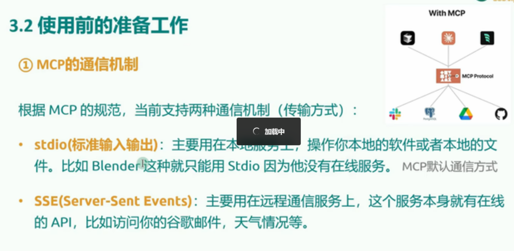

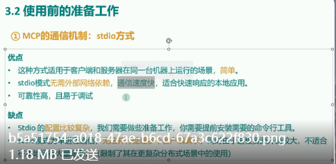

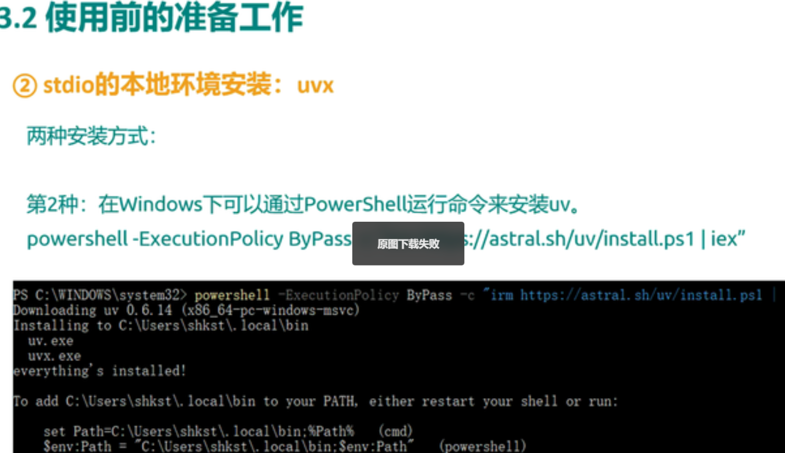

使用stadio前需要安装uv，npx是ts语言用的，uv是Python用的


下载这个插件，配置自定义模型

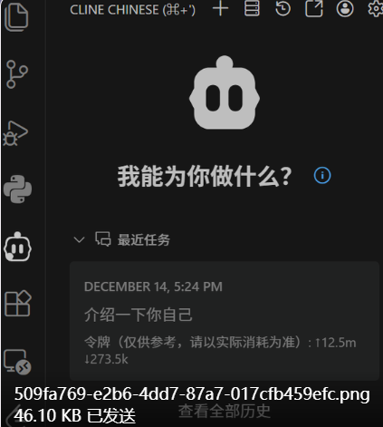

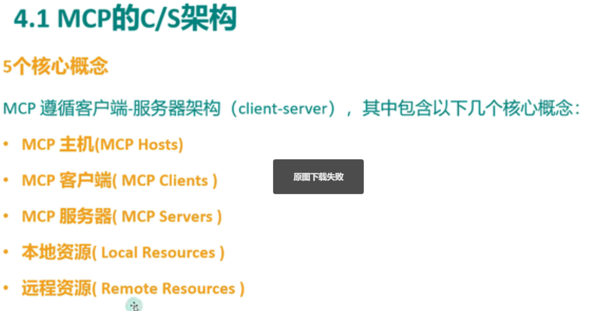

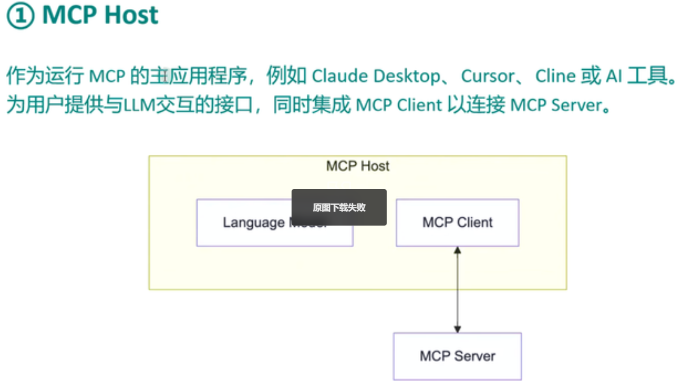

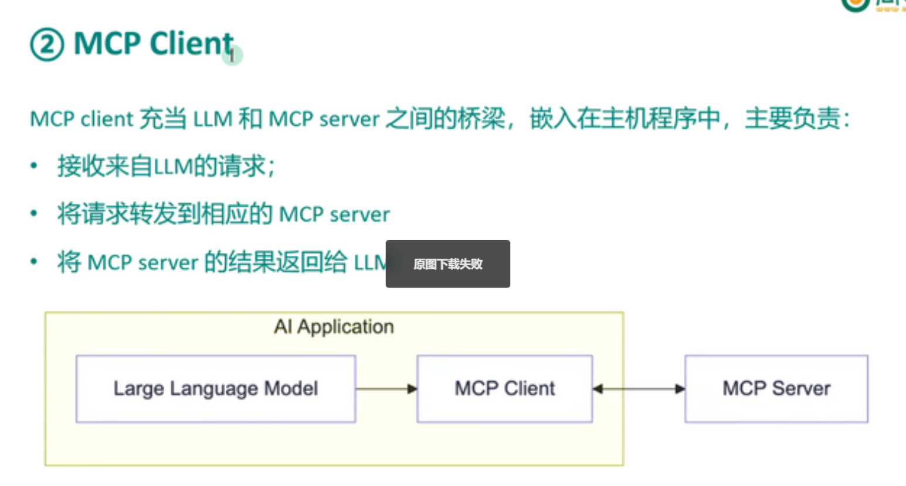

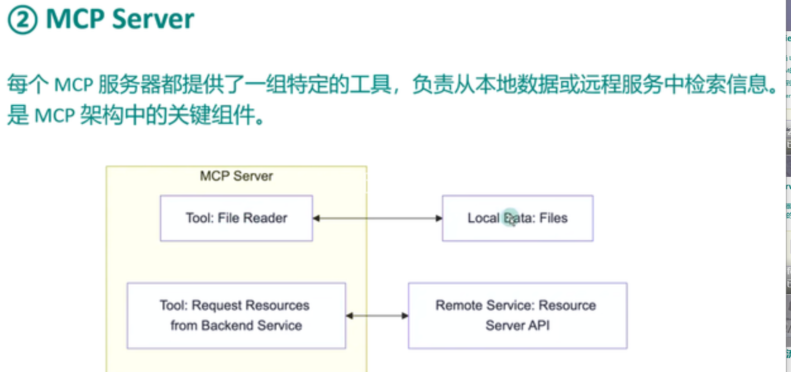

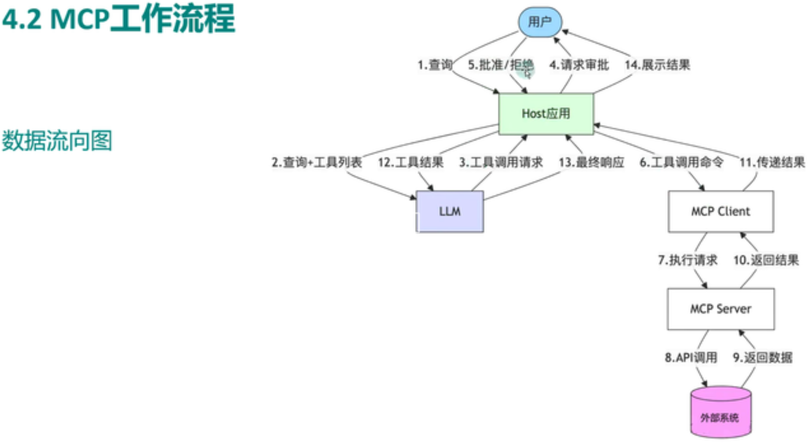


## 数据传输

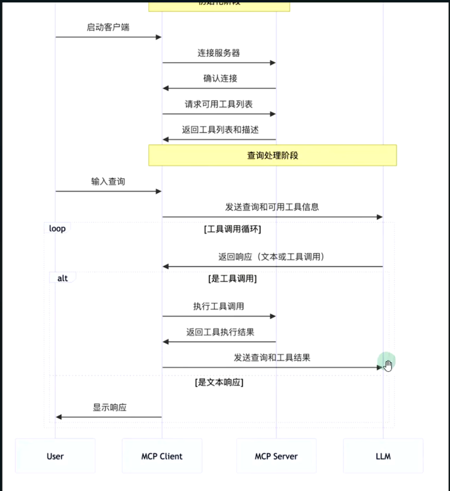

# 自己构建一个MCP服务

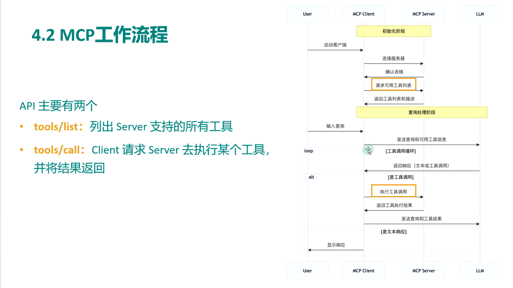

## 创建uv环境

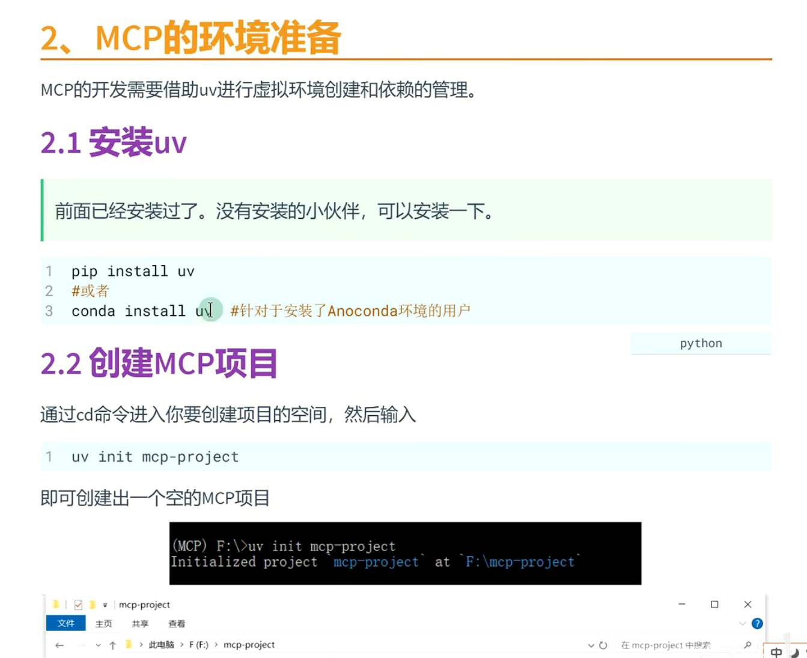

## 初始化新的项目，创建新的.env文件和client.py和server.py三个文件，.env里面存模型调用等配置信息

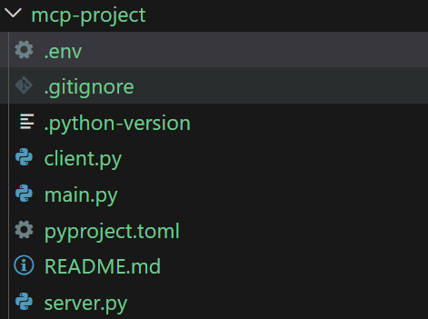

在client中写llm，在server中写tool
