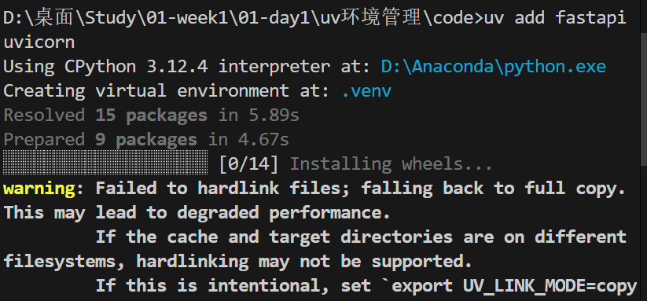
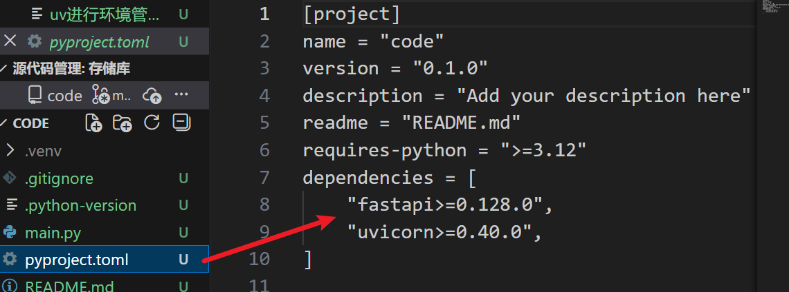

这是一份关于使用 **uv** 进行 Python 依赖管理的详细指南。

**uv** 是由 Astral（Ruff 的开发者）开发的一个极其快速的 Python 包和项目管理器，使用 Rust 编写。它旨在替代 `pip`、`pip-tools`、`pipx`、`poetry` 和 `pyenv`，提供统一且极速的开发体验。

------

### 1. 安装 uv

首先，你需要在你的系统上安装 uv。

- **macOS / Linux:**

  Bash

  ```
  curl -LsSf https://astral.sh/uv/install.sh | sh
  ```

- **Windows:**

  PowerShell

  ```
  irm https://astral.sh/uv/install.ps1 | iex
  ```

- **通过 pip (首选):**

  Bash

  ```
  pip install uv
  ```

------

### 2. 核心工作流：项目管理 (推荐)

这是 uv 现代化的“项目级”工作流，类似于 `Poetry` 或 `npm`，它使用 `pyproject.toml` 和 `uv.lock` 来管理依赖。

#### 第一步：初始化项目

创建一个新目录并初始化。

Bash

```
mkdir my-project
cd my-project
uv init
```

这将创建：

- `.python-version`: 指定项目使用的 Python 版本。
- `pyproject.toml`: 项目配置文件。
- `hello.py`: 一个示例脚本。

#### 第二步：添加依赖 (`uv add`)

不再直接使用 `pip install`，而是使用 `uv add`。这会自动更新 `pyproject.toml` 并生成/更新 `uv.lock` 文件。

Bash

```
# 添加标准依赖
uv add requests pandas

# 添加特定版本的依赖
uv add "flask>=3.0"

# 添加开发依赖 (例如测试工具或 linter)
uv add --dev pytest ruff
```

> **注意：** 当你运行 `uv add` 时，uv 会自动为你创建一个虚拟环境（默认在 `.venv` 目录中），你不需要手动创建它。
> 

已经下载好对应的依赖包了



#### 第三步：运行代码 (`uv run`)

uv 提供了一个便捷的运行命令，它会自动检测并使用项目环境中的 Python，即使你没有显式激活虚拟环境。

Bash

```
# 运行脚本
uv run hello.py

# 运行模块
uv run -m pytest
```

#### 第四步：同步环境 (`uv sync`)，修改.venv，将他同步到与uv.lock相同要求

当你克隆别人的代码，或者手动修改了 `pyproject.toml` 文件后，你需要让你的虚拟环境与配置文件保持一致。

Bash

```
uv sync
```

- 这会确保 `.venv` 中的包与 `uv.lock` 完全匹配。
- 它会安装缺失的包，并**卸载**不再需要的包（这是 pip 做不到的）。

##### 实际场景：

**你的现状 (.venv)：**

- 装有 `Flask`
- 装有 `Pydantic v1.0`

**最新代码的要求 (uv.lock)：**

- 同事要把框架换成 `FastAPI` (新增)
- 同事删除了 `Flask` (废弃)
- 同事把 `Pydantic` 升级到了 `v2.0` (变动)

------

**执行 `uv sync` 后，一键发生三件事：**

1. **删：** 自动卸载 `Flask` (清理垃圾)。
2. **改：** 把 `Pydantic` 从 v1.0 变成 v2.0 (版本对齐)。
3. **增：** 自动安装 `FastAPI` (补充缺失)。

**结果：** 你的环境瞬间和最新代码**分毫不差**。

------

### 3. 高级功能：管理 Python 版本

uv 不仅管理包，还能管理 Python 解释器版本（替代 pyenv）。

#### 安装特定的 Python 版本

Bash

```
uv python install 3.12
uv python install 3.10
```

#### 为当前项目指定 Python 版本

如果你想把当前项目固定在 Python 3.11 环境下：

Bash

```
uv python pin 3.11
```

这会更新项目根目录下的 `.python-version` 文件。下次运行 `uv run` 或 `uv sync` 时，它会自动使用这个版本的 Python。

------

### 4. 兼容模式：作为 pip 的极速替代品

如果你不想使用完整的项目管理功能，只是想把它当作一个更快的 `pip` 来用（例如在 CI/CD 脚本中，或者处理遗留的 `requirements.txt`），你可以使用 `uv pip` 接口。

#### 创建虚拟环境

Bash

```
uv venv
```

#### 安装依赖

Bash

```
# 激活环境 (Linux/macOS)
source .venv/bin/activate
# 激活环境 (Windows)
.venv\Scripts\activate

# 从 requirements.txt 安装 (速度极快)
uv pip install -r requirements.txt

# 直接安装包
uv pip install numpy
```

#### 生成锁定文件

替代 `pip-tools` 的功能：

Bash

```
uv pip compile requirements.in -o requirements.txt
```

------

### 5. 工具管理 (`uvx` / `uv tool`)

uv 还可以替代 `pipx` 来运行一次性的命令行工具，而无需将其安装到全局环境。

Bash

```
# 直接运行工具 (例如 ruff, black, httpie)
uvx ruff check .
uvx httpie https://google.com

# 或者安装工具以便后续使用
uv tool install black
```

------

### 总结：常用命令速查表

| **任务**         | **uv 命令**         |
| ---------------- | ------------------- |
| **初始化项目**   | `uv init`           |
| **添加依赖**     | `uv add X`          |
| **移除依赖**     | `uv remove X`       |
| **运行脚本**     | `uv run script.py`  |
| **同步依赖**     | `uv sync`           |
| **更新全部依赖** | `uv lock --upgrade` |
| **运行临时工具** | `uvx tool`          |

### 为什么选择 uv？

1. **速度：** 比 pip 快 10-100 倍（利用 Rust 的并发和缓存）。
2. **统一性：** 一个工具解决 Python 版本、虚拟环境、依赖管理、工具运行。
3. **磁盘空间：** 使用全局缓存，不同项目使用相同版本的库时，通过硬链接节省空间。

### 实际例子：

以下是**从零开始到成功运行**的详细步骤：

#### 前置准备

确保你的电脑上已经安装了 `uv`（如果没有，参考最开始的安装命令）。

------

#### 第一步：获取代码并进入目录

假设别人的项目代码托管在 GitHub 上（或者你解压了一个压缩包）。

Bash

```
# 1. 克隆项目
git clone https://github.com/username/awesome-project.git

# 2. 进入项目目录
cd awesome-project
```

此时，你目录下应该能看到 `pyproject.toml` 和 `uv.lock` 这两个关键文件。

------

#### 第二步：一键初始化环境 (`uv sync`)

这是最关键的一步。你不需要去官网下载 Python，也不需要手动创建虚拟环境。直接运行：

Bash

```
uv sync
```

**这一行命令在后台为你做了什么？**

1. **检查 Python 版本**：如果项目要求 Python 3.12，而你电脑上只有 3.10，uv 会**自动下载并安装**一个独立的 Python 3.12（不会干扰你系统的 Python）。
2. **创建虚拟环境**：在项目根目录下自动生成 `.venv` 文件夹。
3. **安装依赖**：读取 `uv.lock`，将所有依赖包安装到 `.venv` 中。

> **看到 "Audited X packages in Xms" 就说明成功了。**

------

#### 第三步：运行代码

#### 使用 `uv run` (推荐，最省事)，也可以直接用老办法

你不需要“激活”虚拟环境，直接让 uv 帮你代劳。它会自动使用刚才建好的环境。

Bash

```
# 运行主程序
uv run main.py

# 运行测试
uv run pytest
```

