#  1. Docker基础概念


## Docker概述

 Docker是一种成熟高效的软件部署技术，利用容器化技术为应用程序封装独立的运行环境。每个运行环境即为一个容器，承载容器运行的计算机称为宿主机。


## 技术原理

Docker 的技术原理主要是基于 Linux 内核的 **Namespace（命名空间）** 实现资源隔离、**Control Groups（控制组/cgroups）** 实现资源限制，以及 **UnionFS（联合文件系统）** 实现分层存储，从而在宿主机操作系统之上构建出一个轻量级、相互独立且高度可移植的虚拟化运行环境。

------

### 核心技术拆解

- **Namespace**：负责“隔离”，确保容器内的进程看不见其他容器或宿主机的网络、用户和文件系统。
- **cgroups**：负责“分配”，规定一个容器能使用多少 CPU、内存等物理资源。
- **UnionFS**：负责“存储”，将多层增量内容合并为一个完整的文件系统，这也是 Docker 镜像占用空间小的原因。

**容器本质上还是一个进程，但是容器内部可以看做一个独立的系统**

##  容器与虚拟机的区别:

##   Docker容器: 多个容器共享同一个系统内核。

##   虚拟机: 每个虚拟机包含一个操作系统的完整内核。

  优势: Docker容器比虚拟机更轻量、占用空间更小、启动速度更快。

##  镜像 (Image):

  定义: 镜像是容器的模板，可类比为软件安装包。

  类比: 类似于制作糕点的模具，可用于创建多个糕点（容器），并可分享给他人。

##  容器 (Container):

  定义: 容器是基于镜像运行的应用程序实例，可类比为安装好的软件。

  类比: 类似于模具制作出的糕点。

##  Docker仓库 (Registry):

  定义: 用于存放和分享Docker镜像的场所。

##   Docker Hub: Docker的官方公共仓库，存储了大量用户分享的Docker镜像。

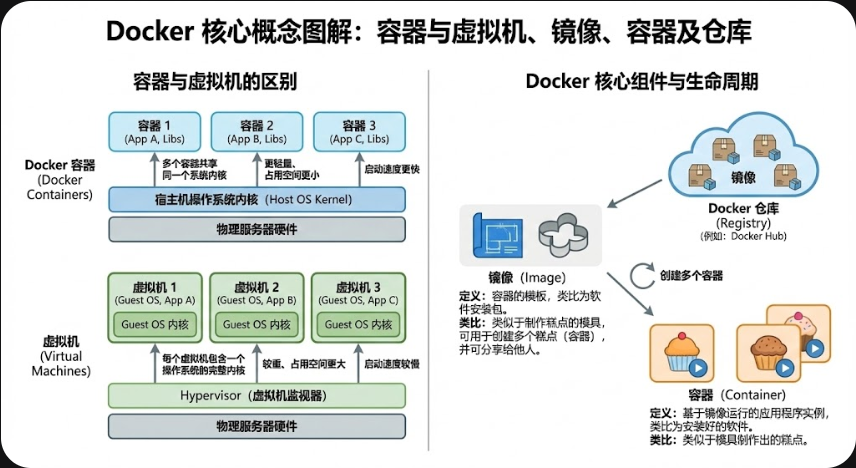

#  2. Docker安装


 运行环境: Docker通常基于Linux容器化技术。在Windows和Mac电脑上，Docker通过**虚拟化一个Linux子系统来运行。**

 推荐环境: Linux系统宿主机是最佳的Docker实战环境。

##  Linux系统安装:

  1. 访问`getdocker.com`获取安装脚本。

  2. 执行安装脚本（例如，通过`curl -fsSL https://get.docker.com -o get-docker.sh`下载脚本，然后执行`sudo sh get-docker.sh`）。

  3. 安装完成后，若非`root`用户，需在所有`docker`命令前添加`sudo`以获取管理员权限。

##  Windows系统安装:

  1. 启用Windows功能: 勾选“Virtual Machine Platform”（虚拟机平台）和“适用于Linux的Windows子系统”（WSL）。

  2. 重启电脑: 根据提示完成重启。

  3. 安装WSL:

   以管理员身份打开命令提示符（CMD）。

   执行`wsl --set-default-version 2`将WSL默认版本设为2。

   执行`wsl --update`安装WSL（国内网络建议添加`--web-download`参数减少下载失败）。

  4. 下载并安装Docker Desktop: 从官方网站下载对应CPU架构的安装包（Windows通常为AMD64），按提示完成安装。

  5. 启动Docker Desktop: 需保持Docker Desktop软件运行。

 6. 验证安装: 在Windows终端输入`docker --version`，若能打印版本号则表示安装成功。
    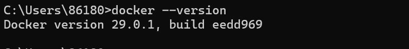

#  3. Docker镜像管理命令

| **类别**     | **核心指令 / 概念**        | **功能与定义**                              | **详细说明与示例**                                           |      |
| ------------ | -------------------------- | ------------------------------------------- | ------------------------------------------------------------ | ---- |
| **下载镜像** | `docker pull`              | 从 Docker 仓库下载镜像到本地环境。          | **示例**： 1. `docker pull nginx` (下载官方最新版) 2. `docker pull n8n/n8n` (下载指定用户/组织镜像) |      |
| **镜像构成** | **镜像完整名称**           | 格式：`[registry]/[namespace]/name:[tag]`   | **组成部分**： 1. **Registry**: 注册表地址 (默认为 `docker.io`，即官方 Hub) 2. **Namespace**: 命名空间 (默认为 `library`，即官方镜像) 3. **Name**: 镜像名称 (如 `nginx`) 4. **Tag**: 版本标签 (默认为 `latest`，可省略) |      |
| **仓库概念** | **Registry vs Repository** | 用于区分“整个仓库服务”与“具体镜像库”。      | **Registry (注册表)**: 整个存放镜像的场所 (如整个 Docker Hub 网站)。 **Repository (镜像库)**: 存储某一个特定镜像（包含不同版本）的地方 (如 Nginx 的页面)。 |      |
| **网络配置** | **镜像加速配置**           | 解决国内网络连接 Docker Hub 慢的问题。      | **Linux**: 修改 `/etc/docker/daemon.json`，添加 `"registry-mirrors": ["地址"]`，并重启服务。 **Win/Mac**: 在 Docker Desktop 设置 -> Docker Engine 中添加 `registry-mirrors` 字段。 |      |
| **查看镜像** | `docker images`            | 列出所有已下载到本地的 Docker 镜像。        | 显示内容包括：仓库名 (Repository)、标签 (Tag)、镜像ID (Image ID)、创建时间及大小。 |      |
| **删除镜像** | `docker rmi`               | 删除本地不再需要的镜像。                    | **参数**：可以使用 **镜像名称** 或 **镜像ID** 进行删除。 **注意**：如果镜像正在被容器使用，需先删除容器。 |      |
| **硬件适配** | **CPU 架构 (--platform)**  | 适配不同的 CPU 指令集 (如 AMD64 vs ARM64)。 | **默认行为**: `docker pull` 会**自动识别**当前宿主机的 CPU 架构并下载对应的镜像版本，无需手动干预。 |      |

## 实际操作 

直接在可视化界面docker.desktop（前提是已经配置好wsl）上进行pull一个镜像

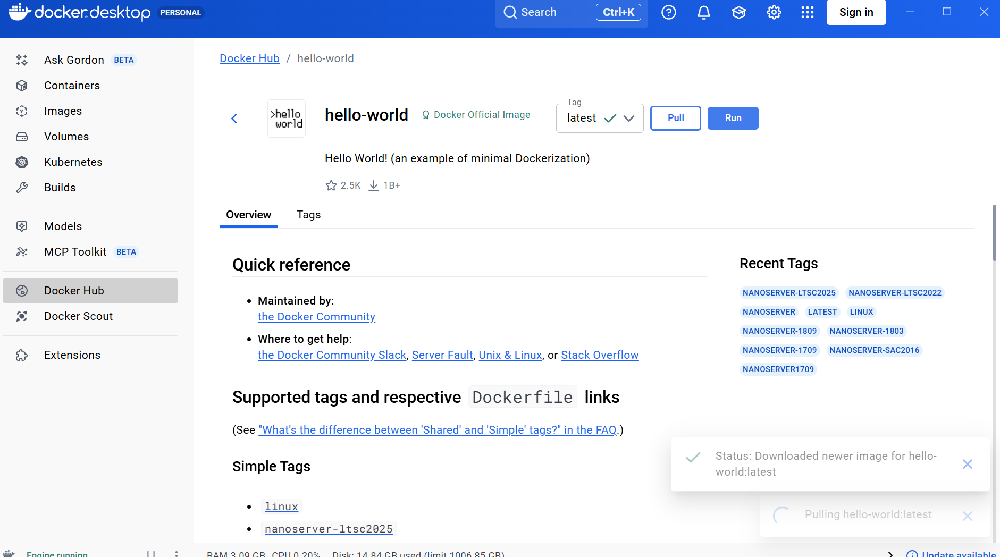

查看新pull下来的镜像

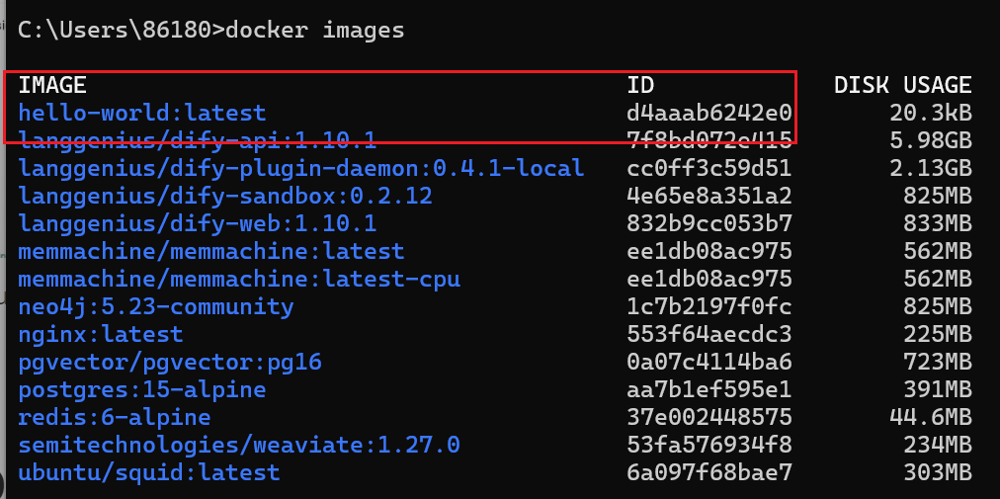

创建并运行容器，如果我们没有指定名字，系统会随机分配一个名字给他

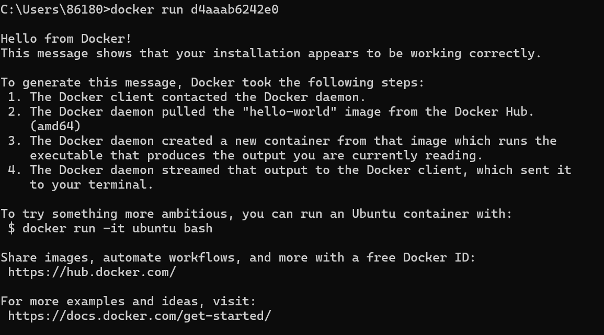

当然也可以直接手动启动

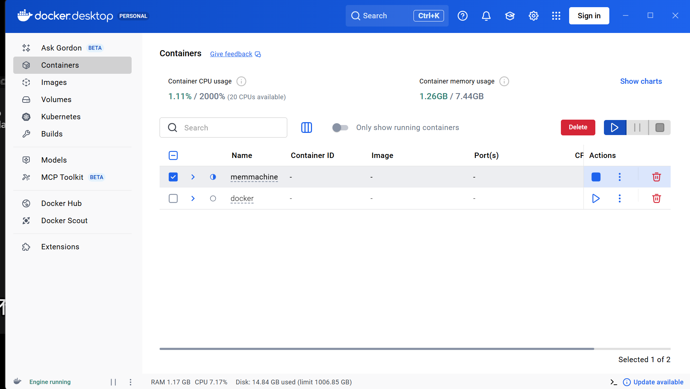

查看已经运行的容器

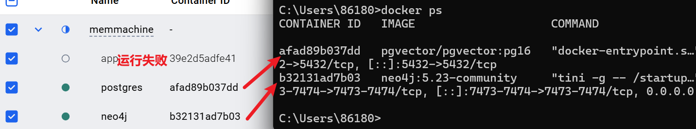

# 4. Docker容器管理命令

## 一、 容器生命周期管理 (Run, Stop, PS)

这是最常用的基础命令，用于控制容器的开关、创建和状态查看。

| **命令分类**   | **命令示例**                | **关键参数说明**                                             | **功能描述**                                                 |
| -------------- | --------------------------- | ------------------------------------------------------------ | ------------------------------------------------------------ |
| **创建并运行** | `docker run [镜像]`         | `--name`: 指定容器名 `-d`: 后台运行 `--rm`: 停止后自动删除 `--restart`: 重启策略(always/unless-stopped) | **最核心命令**。如果本地无镜像会自动拉取。                   |
| **状态查看**   | `docker ps`                 | `-a`: 查看所有容器（含已停止）                               | 查看容器 ID、镜像、运行状态及名称。                          |
| **启动/停止**  | `docker stop/start [ID/名]` | 无                                                           | 停止或重启容器。**注意**：`start` 会保留初次 `run` 时的所有配置。 |
| **仅创建**     | `docker create [镜像]`      | 同 `run`                                                     | 只创建容器对象，不立即启动。                                 |

##  二、 端口、存储与环境配置

这些参数通常配合 `docker run` 使用，用于打通容器与宿主机的联系。

| **配置类型** | **关键参数/命令** | **语法示例** | **核心要点**                                                 |                                                              |
| ------------ | ----------------- | ------------ | ------------------------------------------------------------ | ------------------------------------------------------------ |
| **端口映射** | `-p`              | `-p 8080:80` | **左宿主机 : 右容器**。把宿主机的8080端口转发到容器内的80端口，让外部网络能访问容器服务。 |  |

## 三、 容器调试、内部操作与原理

| **操作类型** | **命令示例**                        | **关键参数**             | **使用场景**                                        |
| ------------ | ----------------------------------- | ------------------------ | --------------------------------------------------- |
| **查看日志** | `docker logs [ID/名]`               | `-f`: 实时刷新日志       | 当程序无法启动或报错时，第一时间查看此日志。        |
| **执行命令** | `docker exec [ID/名]`               | `-it`: 开启交互式终端    | 在**运行中**的容器内执行命令，如 `ls`, `ps` 等。    |
| **交互进入** | `docker exec -it [ID/名] /bin/bash` | `/bin/bash` 或 `/bin/sh` | 进入容器内部“摸摸看”，进行深度调试。                |
| **详细信息** | `docker inspect [ID/名]`            | 无                       | 以 JSON 格式查看容器的 IP、配置、挂载点等底层细节。 |

**-d:传参**

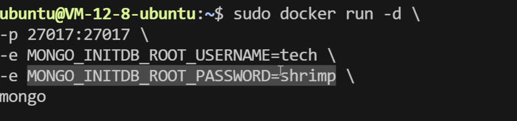

**--name:指定唯一容器名字**

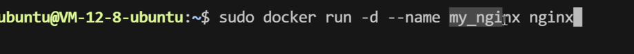

# 5. Dockerfile - 构建镜像的蓝图（重要）

可以把 Dockerfile 理解为一套**自动化的安装脚本**。它的核心逻辑就是：基于一个已经存在的环境（基础镜像），把你的代码、依赖、配置“封存”进去，最终打包成一个开箱即用的“精装修房”。


 定义: Dockerfile是一个文本文件，详细列出了如何制作Docker镜像的步骤和指令，可类比为制作模具的图纸。

## 一个简单的实例，用Docker+fastapi部署一个服务

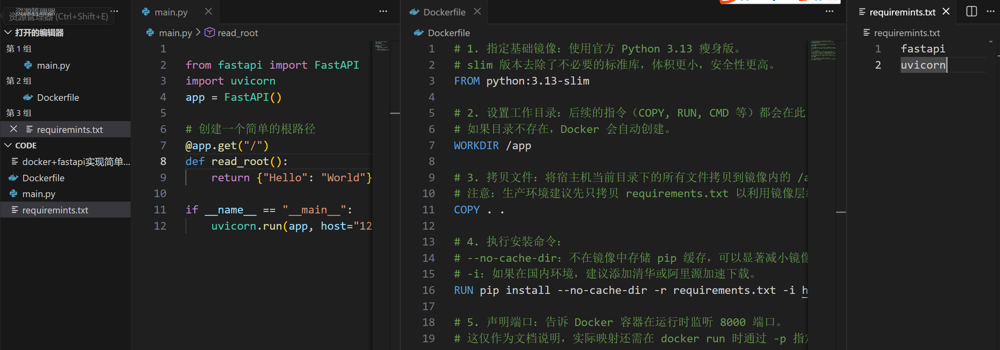 

Dockerfile中的内容：

```dockerfile
# 1. 指定基础镜像：使用官方 Python 3.13 瘦身版。
# slim 版本去除了不必要的标准库，体积更小，安全性更高。
FROM python:3.13-slim

# 2. 设置工作目录：后续的指令（COPY, RUN, CMD 等）都会在此目录下执行。
# 如果目录不存在，Docker 会自动创建。
WORKDIR /app

# 3. 拷贝文件：将宿主机当前目录下的所有文件拷贝到镜像内的 /app 目录。
# 注意：生产环境建议先只拷贝 requirements.txt 以利用镜像层缓存。
COPY . .

# 4. 执行安装命令：
# --no-cache-dir：不在镜像中存储 pip 缓存，可以显著减小镜像体积。
# -i：如果在国内环境，建议添加清华或阿里源加速下载。
RUN pip install --no-cache-dir -r requirements.txt -i https://pypi.tuna.tsinghua.edu.cn/simple

# 5. 声明端口：告诉 Docker 容器在运行时监听 8000 端口。
# 这仅作为文档说明，实际映射还需在 docker run 时通过 -p 指定。
EXPOSE 8000

# 6. 设置启动命令：容器启动后默认执行的程序。
# 使用 ["executable", "param"] 格式（Exec 格式）是官方推荐的最佳实践。
CMD ["python", "main.py"]
```


## 执行docker build -t docker_test .

执行它时，Docker 会根据当前目录下的 `Dockerfile` 创建一个名为 **docker_test** 的镜像。

| **参数**           | **含义**       | **作用**                                                     |
| ------------------ | -------------- | ------------------------------------------------------------ |
| **`docker build`** | 构建指令       | 告诉 Docker 引擎开始从 Dockerfile 创建镜像。                 |
| **`-t`**           | **T**ag (标签) | 为生成的镜像起一个名字（和可选的标签）。格式为 `名字:版本`。 |
| **`docker_test`**  | 镜像名称       | 你指定的镜像名字。如果不加冒号，默认标签为 `latest`。        |
| **`.`**            | **构建上下文** | **极其重要！** 指点 Docker 在**当前目录**寻找 Dockerfile 和相关代码文件。 |

## docker run -d -p 8000:8000 docker_test

运行后，访问8000端口可以看到定义的服务

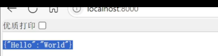

## 基本结构与指令:

| **指令/命令**    | **语法示例**               | **核心功能**                                                 | **注意事项**                                   |
| ---------------- | -------------------------- | ------------------------------------------------------------ | ---------------------------------------------- |
| **FROM**         | `FROM node:18`             | **指定基础镜像**。构建的第一行，决定了镜像的“底座”。         | 建议选择官方、精简版（如 `alpine`）。          |
| **WORKDIR**      | `WORKDIR /app`             | **设定工作目录**。后续的 `RUN`, `COPY`, `CMD` 都会在此目录下执行。 | 若目录不存在，Docker 会自动创建。              |
| **COPY**         | `COPY . .`                 | **拷贝文件**。将宿主机的文件复制到镜像内。                   | 第一个点是宿主机路径，第二个点是镜像内路径。   |
| **RUN**          | `RUN npm install`          | **执行构建命令**。在镜像层创建过程中安装软件、依赖。         | 每一条 `RUN` 都会增加镜像的层数（Layer）。     |
| **EXPOSE**       | `EXPOSE 8080`              | **声明端口**。告诉使用者镜像服务运行在哪个端口。             | **仅是文档属性**，不会自动开启宿主机端口映射。 |
| **CMD**          | `CMD ["node", "app.js"]`   | **容器启动命令**。容器启动时默认执行的程序。                 | 一个 Dockerfile 只能有**一个**有效的 CMD。     |
| **ENTRYPOINT**   | `ENTRYPOINT ["top", "-b"]` | **入口点**。与 CMD 类似但更强，不容易被 `docker run` 后面的参数覆盖。 | 适合将容器作为“可执行程序”使用时。             |
| **docker build** | `docker build -t name .`   | **构建镜像命令**。`-t` 设置镜像名，`.` 代表当前目录。        | 结尾的 **`.`** 非常重要，代表构建上下文路径。  |

##  镜像推送至Docker Hub:

  1. 登录Docker Hub: `docker login`。

  2. 重新标记镜像: `docker tag <本地镜像名称> <你的用户名>/<镜像名称>[:<版本号>]`。推送时镜像名称必须包含用户名作为命名空间。

  3. 推送镜像: `docker push <你的用户名>/<镜像名称>[:<版本号>]`。

  4. 验证: 在Docker Hub网站上可搜索到已推送的镜像，其他用户即可通过`docker pull`下载使用。


#  6. Docker Compose - 多容器编排，手动挡多条run变自动挡一个yaml

##  背景

 当一个完整的应用由多个模块（如前端、后端、数据库）组成时，若将所有模块打包成一个巨大容器，会导致故障蔓延、伸缩性差。若每个模块独立容器化，则管理多个容器（创建、网络配置）会增加复杂性。


 解决方案: **Docker Compose是一种轻量级的容器编排技术，用于管理多个容器的创建和协同工作**。

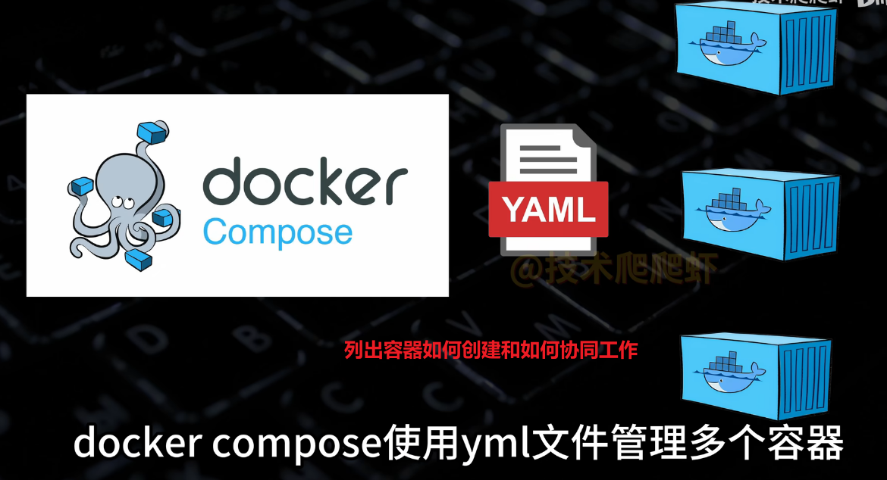


Docker Compose 的核心逻辑是通过一个 **YAML 文件**（通常命名为 `docker-compose.yml`）来定义和运行多个容器应用。你可以将它理解为**“将多个 `docker run` 命令文档化、自动化”**。

### 1. YAML 文件结构详解

YAML 文件将原本散落在命令行中的参数，结构化地组织在 `services` 顶级元素下：

| **YAML 字段**      | **对应 docker run 参数** | **说明**                                               |
| ------------------ | ------------------------ | ------------------------------------------------------ |
| **`services:`**    | (无)                     | 顶级元素，下属每个子项代表一个独立的容器。             |
| **`mongodb:`**     | `--name mongodb`         | **服务名称**，既是容器名的一部分，也是内网访问的域名。 |
| **`image:`**       | `镜像名`                 | 指定启动容器所需的镜像。                               |
| **`environment:`** | `-e`                     | 设置环境变量（如数据库密码）。                         |
| **`volumes:`**     | `-v`                     | 挂载宿主机目录或卷，实现数据持久化。                   |
| **`ports:`**       | `-p`                     | 端口映射（宿主机端口:容器端口）。                      |
| **`depends_on:`**  | (无)                     | **启动顺序**：确保依赖的服务（如数据库）先于应用启动。 |

------

### 2. 核心网络特性：服务发现

Docker Compose 会为该文件自动创建一个**默认虚拟子网**：

- **自动加入**：文件中定义的所有容器都会自动加入此网络。
- **相互访问**：容器间无需知道 IP，直接通过**服务名称**（如 `http://mongodb:27017`）即可通信。

------

### 3. 常用管理命令

Compose 命令通常在 `docker-compose.yml` 文件所在目录下执行：

- **`docker compose up -d`**：**一键启动**所有服务并在后台运行（自动创建网络和容器）。
- **`docker compose down`**：**彻底清理**，停止并删除容器、网络和镜像缓存。
- **`docker compose stop / start`**：仅停止/启动现有容器，不进行删除操作。
- **`docker compose -f <filename>.yml up`**：指定特定的配置文件进行部署。

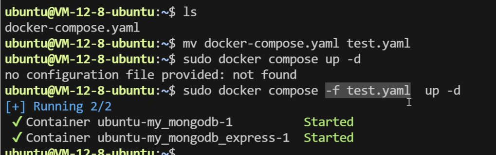

------

### 4. 场景定位：Compose 

| **特性**     | **Docker Compose**                   |
| ------------ | ------------------------------------ |
| **定位**     | **轻量级单机编排**                   |
| **适用场景** | 个人开发、本地测试、小规模单机应用。 |
| **复杂度**   | 极低，学习成本小。                   |

------

> 可以直**接把你的 `docker run` 命令丢给 AI，让它帮你自动转化为 `docker-compose.yml` 文件**。

上面的docker run -d -p 8000:8000 docker_test命令转为docker-compose.yml文件如下

```yaml
services:
  web_app:              # 服务名称（对应之前 docker_test 的逻辑含义）
    image: docker_test  # 对应指令中的镜像名
    ports:
      - "8000:8000"     # 对应 -p 8000:8000 (宿主机端口:容器端口)
    restart: always     # 额外建议：容器崩溃或重启后自动拉起
```

多容器转docker-compose.yml：

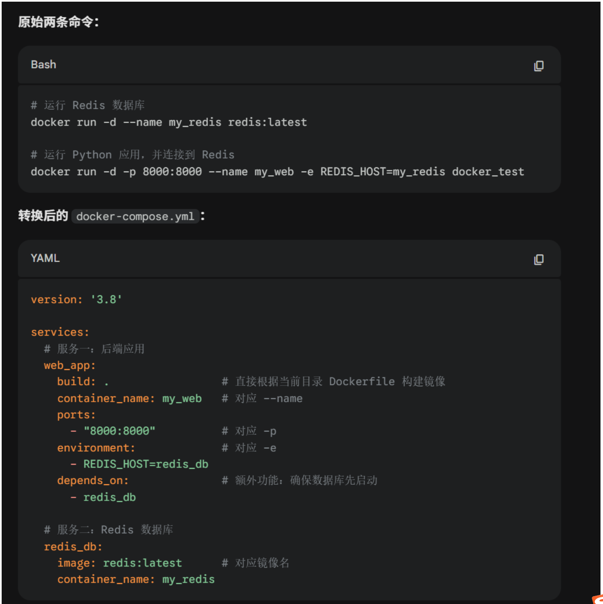
