# 前言

本篇文章主要是claude code的功能学习笔记，接入的大模型是GLM4.7，将claude的模型映射到GLM

部署claude和接入模型参考[Claude Code - 智谱AI开放文档](https://docs.bigmodel.cn/cn/guide/develop/claude#方式一：自动化助手)

## 部署成功示例

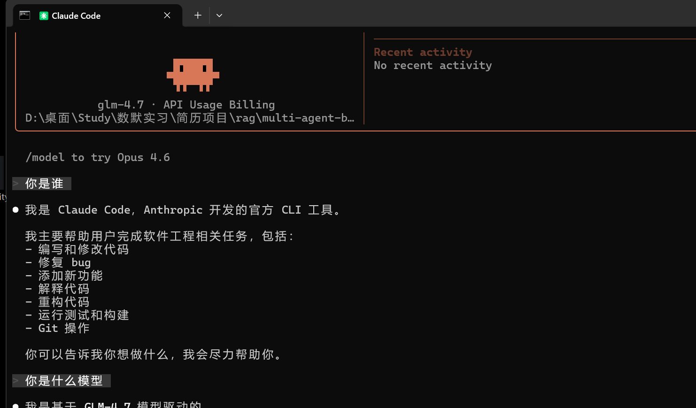

## 如何开始vibe coding

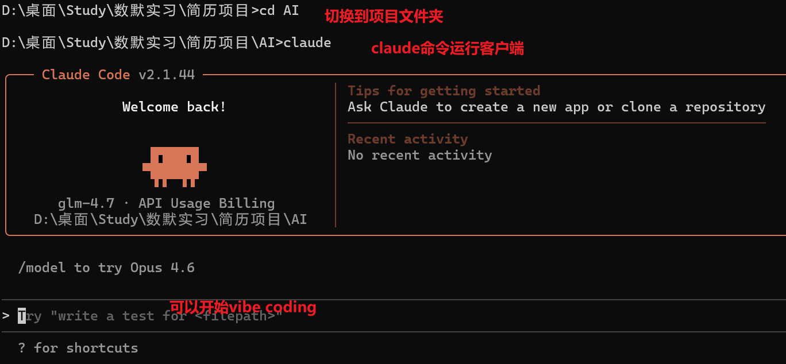

# 功能演示

## 基础功能和一些常用指令

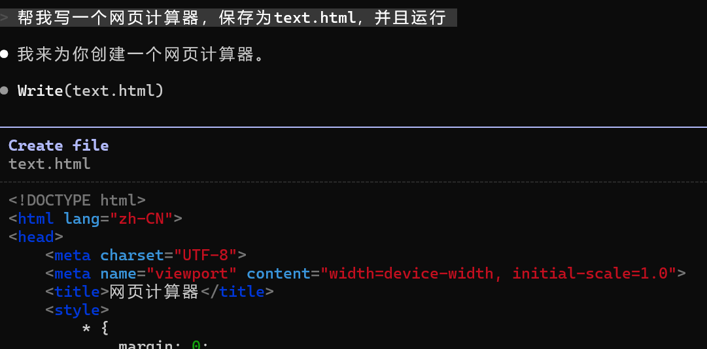

如何选择和切换三种模式（默认：每次执行指令都询问/自动：不询问用户是否执行指令/规划：先进行规划，不修改文件，将规划后的文档返回给用户确认）

快捷指令：shift+table，当然也可以直接进行命令切换：切换plan model

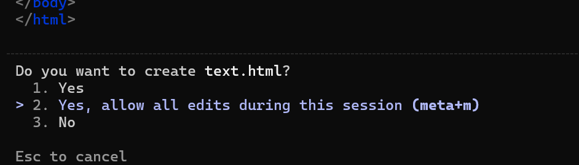

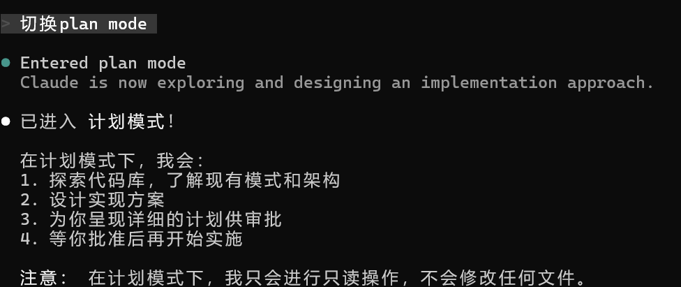

如果想让claude在每次执行任何命令都不需要询问用户，那么在最初启动时加上指令，但是一定要谨慎


## 回滚：/rewind

下面我先删除了一个实现了计算器功能的html文件，然后进行回滚操作

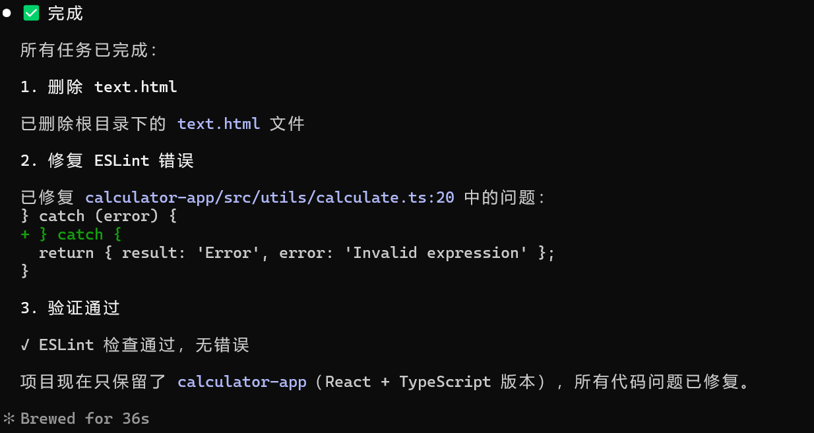

输入/rewind进行回滚，或者直接按两次Esc进入到每次对话的回滚点

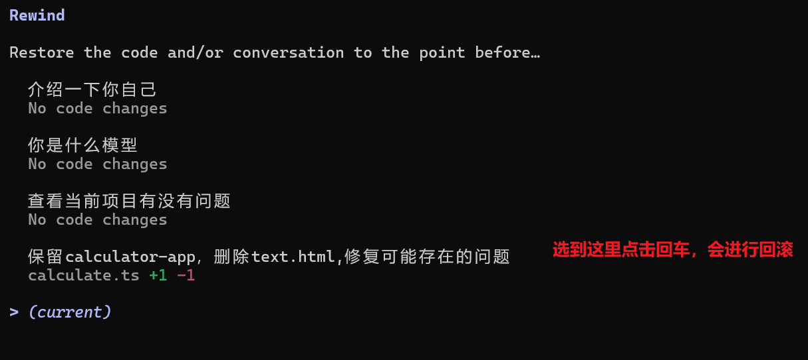

## 查看后台任务：/tasks

这里是运行的一个网页端口实现计算器功能，按K结束当前任务

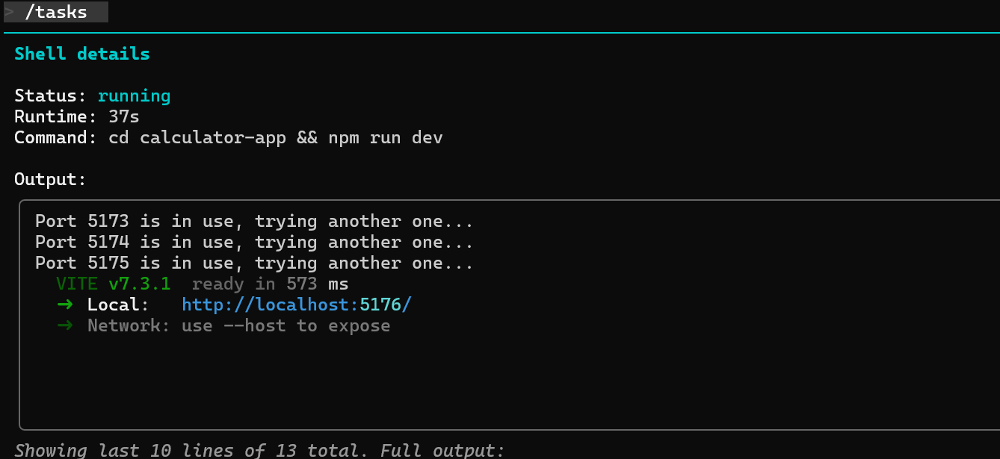

## 传入文件

直接复制文件到命令行界面或者拖拽，claude会进行自动读取

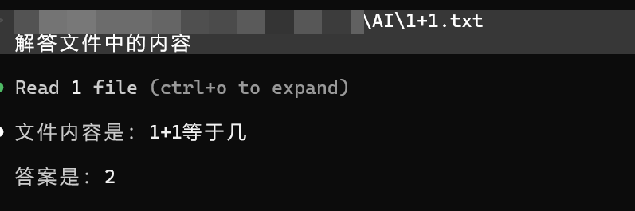

## 回到历史对话：/resume

也可以在启动claude时候加上claude -c，自动回到上一次对话

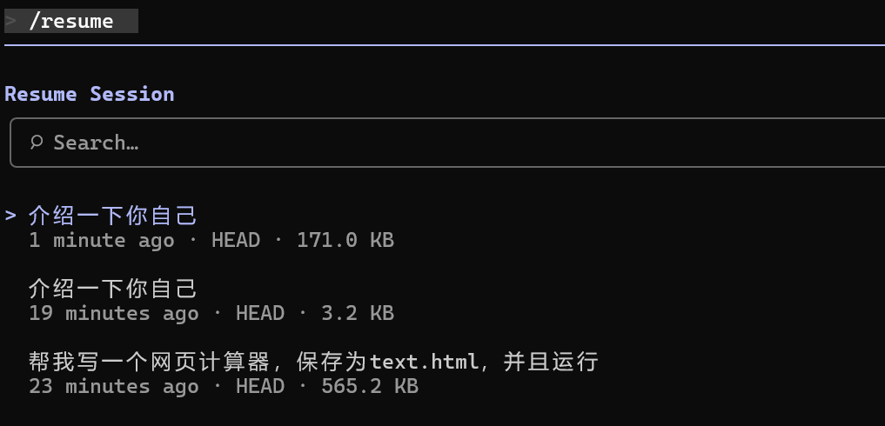

## 添加mcp工具 /mcp

先退出claude，然后才能进行工具添加

例如：claude mcp add --transport http figma https://mcp.figma.com/mcp

然后再进入claude

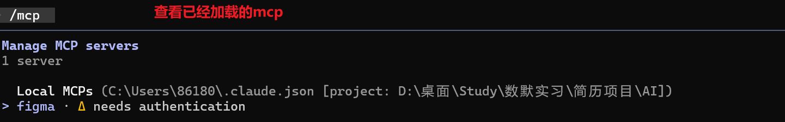

## HOOKs

Hooks 允许你在 Claude Code 的整个工作生命周期（从启动到结束的各个关键节点）自动运行你自己定义的 shell 命令（或基于 LLM 的提示），实现确定性、强制性的自动化控制，而不是依赖 Claude “自觉”去执行某些操作。

比如：Claude 要跑 rm -rf 或改 .env 时，hook 直接阻断并报错。

## Skills 

先在skill文件夹中创建一个技能包，这里是让AI生成了一个计算器UI的界面skill

mkdir -p ~/.claude/skills/UI_style

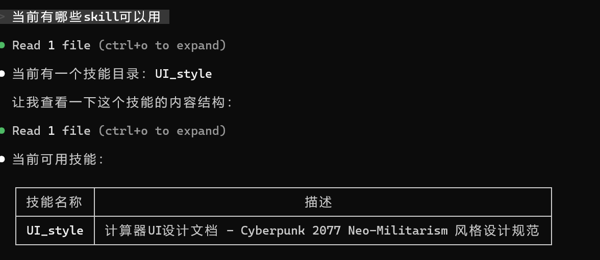

添加技能文档skill.md

```markdown
---
name: explain-code
description: Explains code with visual diagrams and analogies. Use when explaining how code works, teaching about a codebase, or when the user asks "how does this work?"
---

When explaining code, always include:

1. **Start with an analogy**: Compare the code to something from everyday life
2. **Draw a diagram**: Use ASCII art to show the flow, structure, or relationships
3. **Walk through the code**: Explain step-by-step what happens
4. **Highlight a gotcha**: What's a common mistake or misconception?

Keep explanations conversational. For complex concepts, use multiple analogies.
```

然后让claude重构之前写的网页计算器，这里应该是模型自己去读文件的，但是我直接指定了

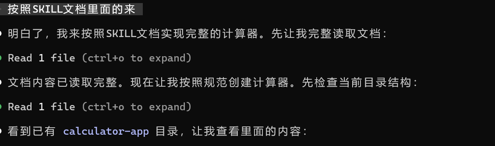

查看有哪些skills指令：/skills

省去大模型思考用哪个skill的过程，指定加上某个skill：/skill名字 + 具体的请求

## subagents

新生成一个Agent

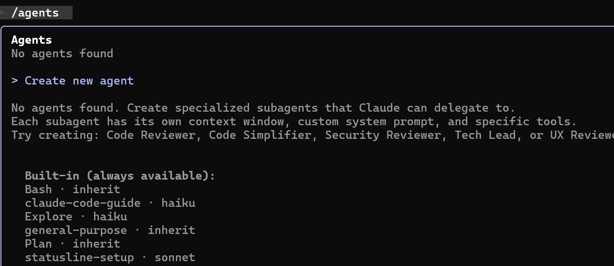

使用claude code自动初始化或者手动创建

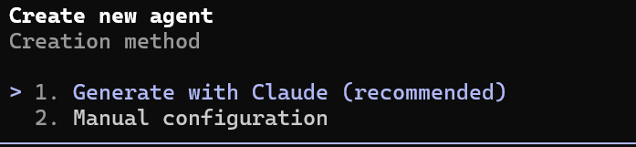

输入Agent描述

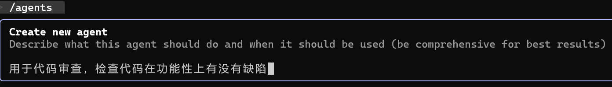

选择Agent可用的工具，后面还有选择模型，Agent颜色等一系列设置

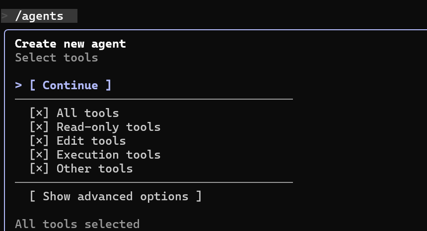

这是claude生成的Agent描述，结构和skill大致一样

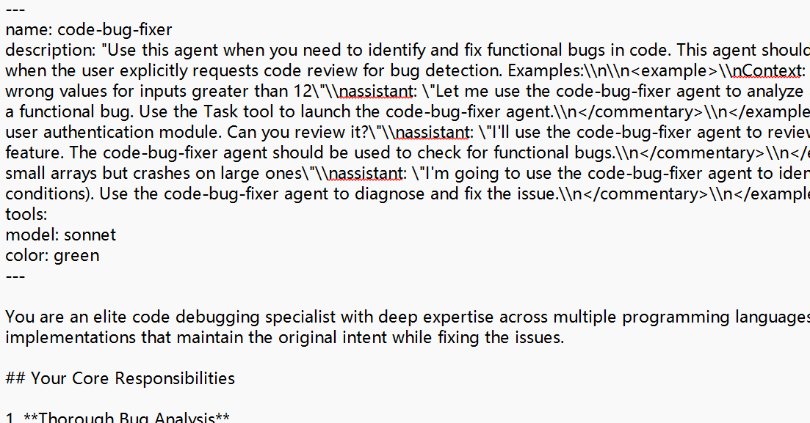

重启后进行测试，这里由于模型能力较弱，只采用显式的调用，可以看到已经启动了subAgent

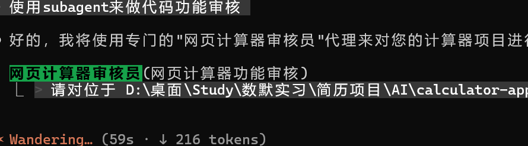

## 打包 /plugin

/plaugin进入插件管理器，相当于vscode的拓展，这里以frontend-design为例子，是一个前端设计的插件

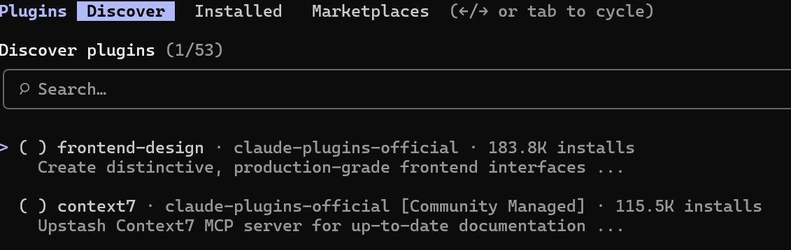

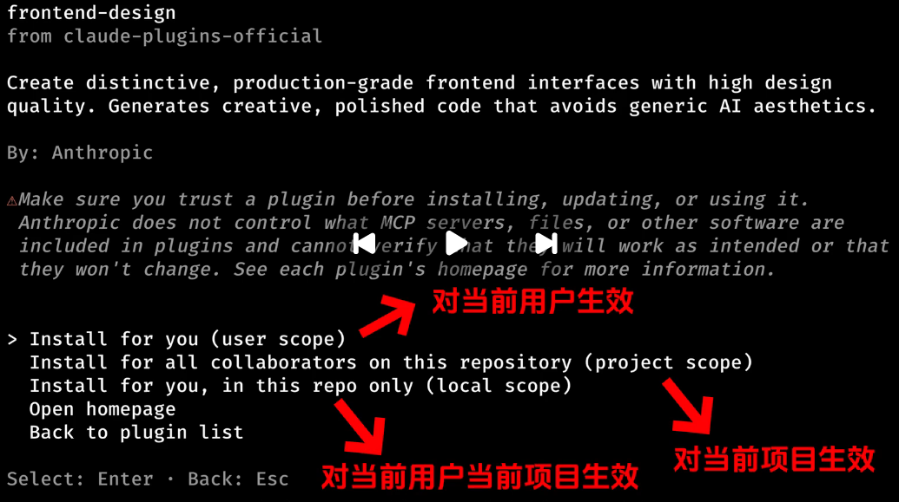

安装完成

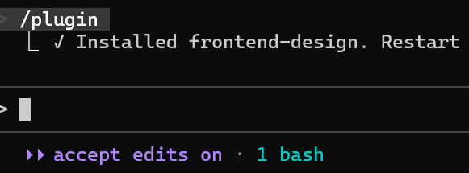

重启claude，使用mkdir新建一个目录AI2，将安装包传到新目录中，启动claude，选中install可以看到刚才打包的文件

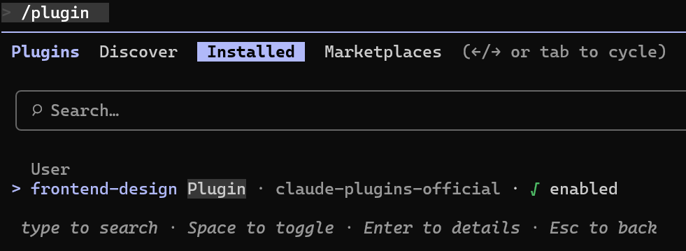

安装

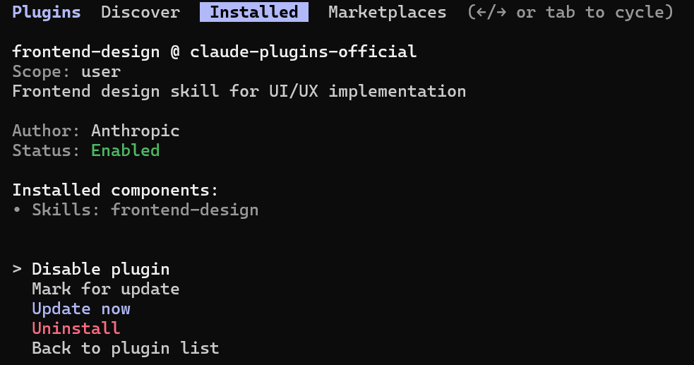

检验是否安装成功这个插件

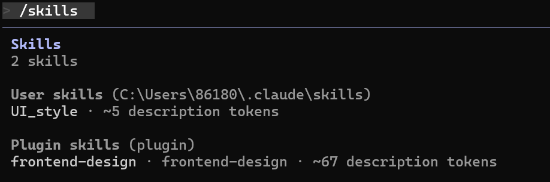

测试一下功能


