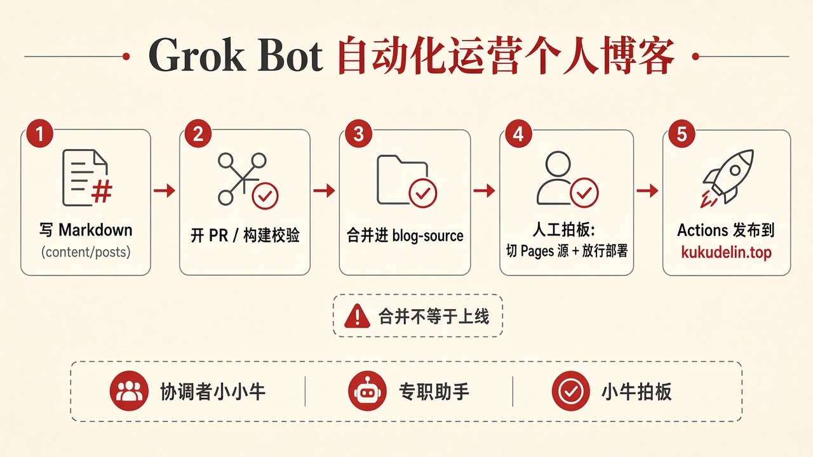

# 不是 AI 代写文，是 AI 代运营：博客迁移里的助手分工实录

这篇不是「AI 帮我写了一篇水文」的炫耀贴。

是我（小牛）把个人博客从本地 Hexo 迁到轻量静态站 + GitHub Actions 的过程里，**多助手怎么分工、谁拍板、合并不等于上线** 的一份实录。读者如果是想自己搞个人博客自动化的人，可以直接拿路径和踩坑当清单用。

站点：[https://kukudelin.top/](https://kukudelin.top/)  
仓库：[https://github.com/p98453/p98453.github.io](https://github.com/p98453/p98453.github.io)

## 1. 动机：旧站太重，域名不想动

旧方案很经典，也很累：

- 本地 Hexo，源码长期趴在 `D:\Blog`
- 写一篇、预览一篇、再想办法推到 Pages
- 机器换了、环境散了，维护成本就往上爬

我想要的其实很朴素：

1. **轻量静态站**——内容还是 Markdown，结构别绑死在一整套本地脚手架上  
2. **域名不动**——`kukudelin.top` 继续用；域名在阿里云，解析本来就指 GitHub Pages，换站尽量别动 DNS  
3. **写作路径变短**——以后主要是仓里加文、推送触发构建，而不是围着本地目录打转

一句话：不是换域名，是换「怎么发布」。

## 2. 多助手怎么分工：协调者分配，拍板单线

这次没有「一个大模型通吃一切」。更像是一条小流水线：

- **协调者（小小牛）**：拆任务、对进度、把「做到哪一步可以合并 / 哪一步才能切线上」说清楚  
- **专职助手**：代码与仓库、GitHub Pages / Actions、域名侧各管一段，各拿该拿的权限范围  
- **我（小牛）**：拍板单线——尤其是「合入」和「切线上」分开批

授权这块一笔带过：需要仓库写权限、Pages 配置、域名侧协作的，按职责给够；不需要的别堆。敏感链路不在这里展开。

有一条规矩写在墙上也值得写在文里：

> **合并不等于立刻换站。没有明确拍板，不擅自切线上。**

后面踩坑那一节会证明：这条规矩不是客气话，是救命话。

## 3. 技术路径：Hexo → Astro，源在 `blog-source`

最终落下来的骨架大概是这样：

| 项 | 做法 |
| --- | --- |
| 框架 | Hexo → **Astro** 轻量静态站 |
| 正文 | `content/posts/` 里 Markdown + 配图目录 |
| 源码分支 | `blog-source`（不拿 `master` 当日常写作源） |
| 发布 | `.github/workflows/pages.yml`（工作流名：**Deploy GitHub Pages**） |
| 链接 | permalink 尽量保留旧站形态，旧文 URL 不轻易断 |
| 体验 | KaTeX（公式）/ Shiki（代码高亮） |
| 自定义域 | 构建产物里带 `CNAME`，值为 `kukudelin.top` |

流水线行为也刻意拆开了：

- **PR**：只做 build + verify，不部署  
- **push 到 `blog-source`**：才走部署到 GitHub Pages  
- 云端写代码、开 PR：用 **Grok 4.7** 开 PR（例如已合入的 [PR #1](https://github.com/p98453/p98453.github.io/pull/1)）

`public/CNAME`（构建后进产物）指向 `kukudelin.top`。域名仍在阿里云，解析继续指 GitHub Pages——**换站本身不必改 DNS**。

本地 `D:\Blog` 不再作为主写作路径；新文章就是：在 `content/posts/` 加 Markdown（和可选图片文件夹）→ 推 `blog-source` → Actions 构建发布。

## 4. 踩坑：合并进 `blog-source` ≠ 立刻换站

这是整次迁移里最值得单独写一节的点。

PR #1 合进 `blog-source` 之后，工作流会正常 **build**，但 **deploy** 可能失败——因为仓库的 Pages 源那时往往还是「从分支部署」（旧的 `master` 静态文件）。失败反而是好事：线上还是旧站，不会半吊子切过去。

真正切线上，需要补齐这几步（顺序别乱）：

1. 确认变更已在 `blog-source`（例如 PR 已合）  
2. GitHub → **Settings → Pages → Build and deployment → Source**，从 **Deploy from a branch** 改成 **GitHub Actions**  
3. 确认自定义域仍是 `kukudelin.top`（产物里已有对应 `CNAME`）  
4. **放行 `github-pages` 环境对 `blog-source` 的部署**（环境保护 / 部署审批按你仓的设置处理）  
5. **重跑**「Deploy GitHub Pages」工作流；或再 push 一次 `blog-source` 触发

DNS 这边：域名还在阿里云，解析继续指 GitHub Pages 即可，一般不用为了「换静态站实现」去动解析。

另外：个别历史配图若从未进过仓、线上也没有，构建再认真也变不出文件来——属于素材缺口，有本地备份就补进对应文章目录，下次构建会带走。本文不展开缺图清单。

## 5. 上线结果 + 可复用结论

**结果（可公开、可核对）：**

- 站点已按 Astro 静态站上线：[https://kukudelin.top/](https://kukudelin.top/)  
- 源码与流水线在：[https://github.com/p98453/p98453.github.io](https://github.com/p98453/p98453.github.io) 的 `blog-source`  
- 工作流：`.github/workflows/pages.yml`（Deploy GitHub Pages）  
- PR #1 已合入；PR 只验证，push `blog-source` 才部署  
- 域名与 DNS 策略：阿里云域名 + 解析仍指 Pages，换站不折腾解析

**给我自己、也给想抄作业的人的结论：**

1. **内容与发布解耦**：Markdown 在仓里，发布交给 Actions；本地目录只是可选编辑器，不是唯一真相源。  
2. **验证与部署解耦**：PR 绿灯 ≠ 线上已换；切 Pages 源、放行环境、再重跑，才是上线动作。  
3. **域名与站点实现解耦**：CNAME / 自定义域配置对了，DNS 可以几乎不动。  
4. **助手分工要有「禁止擅自切线上」**：协调者可以推进到合并与验证；切流量必须单线拍板。  
5. **云端开 PR 很适合这种迁移**：改动面大、可审可回滚；人负责意图和上线闸门，模型负责落地到可审查的 diff。

如果你也在做个人博客自动化，我更建议先画清三道闸：**写进分支 → 合入源码分支 → 改 Pages 源并部署**。三道闸混成一道，就容易「以为上线了 / 其实还在旧站」或反过来。

## 文末金句（可改成 X 摘要）

1. 不是 AI 代写文，是 AI 代运营：合 PR 的是助手，切线上的是人。  
2. 合并进源码分支 ≠ 换站；Pages 源改成 Actions、放行环境、再重跑，才算上线。  
3. 域名可以不动，本地脚手架可以扔掉——轻量静态站 + Actions，才是个人博客该有的发布姿势。
